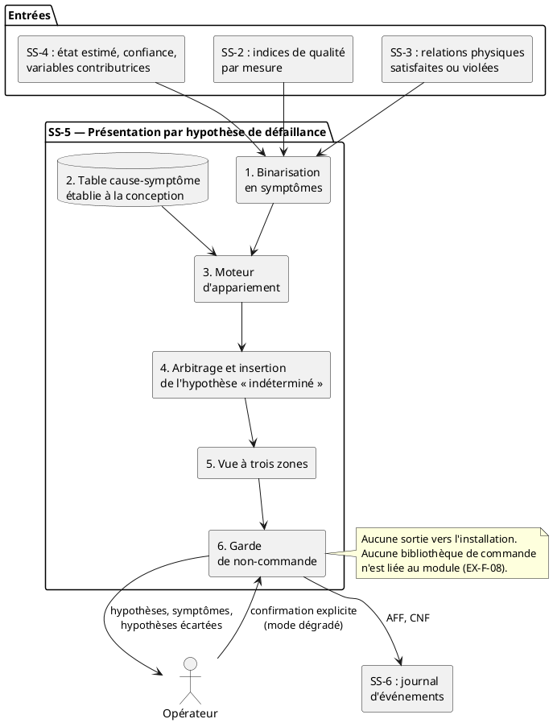

# SS-5, concept C : présentation par hypothèse de défaillance

**Fonction (tableau 1-4 du plan de projet).** Présenter l'état, la confiance et les contributions à l'opérateur, sans commander l'installation.
**Lot.** L8 · **Auteur.** Christian Kévin Sawadogo · **Réviseur.** à désigner · **Version.** v0.1, 21 octobre 2026

---

## 1. Présentation du concept

Les trois concepts de cette fonction se distinguent par le niveau de synthèse que la machine impose, donc par le partage du travail de diagnostic entre le système et l'opérateur. Le concept A présente chaque grandeur avec son écart et laisse l'opérateur faire le rapprochement. Le concept B présente un état synthétique de la boucle. Le concept C va un cran plus loin : il présente les **causes physiques compatibles avec les observations**, ordonnées par qualité de correspondance.

Le problème auquel il répond est le suivant. Ce que SS-4 produit est un état, un niveau de confiance et des variables contributrices, c'est-à-dire une information de la forme « la température et le débit s'écartent de l'attendu ». Mais la question que l'opérateur doit trancher n'est pas celle-là : c'est de savoir **si c'est un capteur qui ment ou la boucle qui dérive**, parce que les deux situations appellent des suites opposées. Dans le concept A comme dans le concept B, ce saut du symptôme vers la cause reste entièrement à la charge de l'opérateur, et il le fait de tête, sans trace. Le concept C fait ce saut explicitement, avec une règle écrite à la conception, et l'expose à l'écran avec ce qui le soutient.

Le principe qui rend ce saut possible est une propriété physique de la boucle, et c'est le cœur du concept : **un défaut de capteur fait apparaître un écart sur une variable tout en laissant les relations physiques entre les trois variables insatisfaites, alors qu'une dérive réelle du procédé fait bouger les trois variables de façon cohérente et laisse ces relations satisfaites.** Autrement dit, la cohérence entre la température, la pression et le débit est elle-même une information, et c'est cette information que les concepts A et B n'exploitent pas. Un bilan d'énergie et une loi de perte de charge suffisent à séparer les deux familles de causes.

Ce concept est aussi celui qui s'approche le plus de la frontière de la commande, puisqu'une liste de causes ordonnée se lit comme une recommandation d'action. Le respect d'EX-F-08 n'est donc pas un détail de formulation ici, c'est une contrainte de conception traitée à la section 3 par une composante dédiée.

---

## 2. Schéma de la solution

Le schéma ci-dessous donne la chaîne de traitement et les frontières du module. Il ne remplace pas le texte des sections 3 et 4 : il situe les composantes les unes par rapport aux autres et montre qu'aucun chemin ne part vers l'installation.

---

## 3. Description des composantes

**1. Binarisation en symptômes.** Transforme les entrées continues en un vecteur de symptômes actifs ou inactifs. Chaque symptôme possède son propre seuil, qui ne sert qu'à la binarisation et non à décider d'une anomalie, la décision restant du ressort de SS-4. Les symptômes retenus pour cette boucle sont les suivants.

| Réf. | Symptôme observable | Source |
|---|---|---|
| S1 | Écart sur la température | SS-3 |
| S2 | Écart sur la pression | SS-3 |
| S3 | Écart sur le débit | SS-3 |
| S4 | Bilan d'énergie non satisfait | SS-3 ou SS-2 |
| S5 | Loi de perte de charge non satisfaite | SS-3 ou SS-2 |
| S6 | Indice de qualité bas ou donnée absente | SS-2 |
| S7 | Écart croissant lentement plutôt qu'en saut | SS-4 |

**2. Table cause-symptôme.** Base de connaissance établie à la conception, et non apprise sur des données. Chaque ligne est une cause candidate, chaque colonne un symptôme. Elle est le livrable d'ingénierie central de ce concept, parce que c'est elle qui porte le raisonnement et qu'elle est relisible par un tiers.

| Réf. | Cause candidate | S1 | S2 | S3 | S4 | S5 | S6 | S7 |
|---|---|:-:|:-:|:-:|:-:|:-:|:-:|:-:|
| C1 | Dérive du capteur de température | ✓ | | | ✓ | | | ✓ |
| C2 | Dérive du capteur de pression | | ✓ | | | ✓ | | ✓ |
| C3 | Dérive du capteur de débit | | | ✓ | ✓ | ✓ | | ✓ |
| C4 | Défaut franc de capteur, valeur hors plage | | | | | | ✓ | |
| C5 | Perte de communication, donnée indisponible | | | | | | ✓ | |
| C6 | Baisse réelle du débit de la pompe | ✓ | ✓ | ✓ | | | | |
| C7 | Dégradation de l'échange thermique | ✓ | | | ✓ | | | ✓ |
| C8 | Indéterminé | | | | | | | |

La lecture de cette table rend visible le principe énoncé à la section 1. Les causes C1 à C3 violent une relation physique sans que les trois variables bougent ensemble, ce qui est la signature d'un capteur. La cause C6 fait bouger les trois variables en laissant les relations satisfaites, ce qui est la signature du procédé. La cause C3 se distingue de C1 et C2 parce que le débit intervient dans les deux relations à la fois.

**3. Moteur d'appariement.** Compare le vecteur de symptômes actifs aux signatures de la table et produit, pour chaque cause, un degré de correspondance, soit le nombre de symptômes concordants rapporté au nombre de symptômes attendus par la signature. Ce degré est une qualité d'appariement et ne doit jamais être présenté comme une probabilité.

**4. Arbitrage et insertion de l'hypothèse « indéterminé ».** Applique trois règles, dans cet ordre.

- Si un symptôme S6 est actif au-delà de N cycles, l'hypothèse « indéterminé » passe en tête et aucune cause n'est présentée comme probable. C'est la traduction directe d'EX-F-06.
- Si aucune signature n'atteint le degré de correspondance minimal, « indéterminé » passe en tête.
- Si plusieurs causes obtiennent le même degré, elles sont affichées au même rang et jamais départagées arbitrairement.

**5. Vue à trois zones.** Zone 1, les hypothèses retenues avec leur degré de correspondance. Zone 2, les symptômes qui les soutiennent, avec le renvoi aux variables et à leur écart, ce qui satisfait EX-F-05. Zone 3, les hypothèses écartées et le motif de leur rejet, ce qui est la condition pour que l'outil se justifie au lieu d'orienter.

**6. Garde de non-commande.** Trois dispositions. Les libellés d'hypothèse sont des énoncés de constat et jamais des verbes d'action, donc « écart compatible avec une dérive du capteur de débit » et non « vérifier le capteur de débit ». Aucune bibliothèque capable d'écrire vers un équipement n'est liée au module, ce qui se vérifie par un inventaire automatique des dépendances. Le passage en mode dégradé passe par un dialogue de confirmation qui restitue à l'écran l'état, la confiance et les hypothèses présentées, de sorte que le journal atteste de ce que l'opérateur avait sous les yeux.

---

## 4. Description du fonctionnement

À chaque cycle, le module reçoit l'état estimé, le niveau de confiance et les variables contributrices de SS-4, les indices de qualité de SS-2 et l'état des relations physiques de SS-3. Il binarise ces entrées en un vecteur de symptômes, puis apparie ce vecteur aux signatures de la table. L'arbitrage applique ensuite ses trois règles et produit une liste ordonnée d'hypothèses, l'entrée « indéterminé » y occupant un rang comme les autres. La vue affiche les hypothèses retenues, les symptômes qui les soutiennent et les hypothèses écartées avec leur motif. Rien n'est émis vers l'installation.

Lorsque l'opérateur demande le passage en fonctionnement dégradé, le dialogue de confirmation lui présente l'état, la confiance et les hypothèses affichées, et exige une action positive distincte d'une simple fermeture. La confirmation et son contenu sont journalisés auprès de SS-6.

Le concept est conçu contre une erreur d'interprétation précise, l'ancrage sur la première hypothèse proposée. Quatre dispositions y répondent : l'ordre est celui du degré de correspondance et jamais celui de la gravité, une hypothèse n'est jamais affichée seule, les hypothèses écartées restent visibles avec leur motif, et les ex aequo ne sont pas départagés.

---

## 5. Limites du concept et points à trancher avec l'équipe

**Dépendance aux autres concepts retenus.** Les symptômes S4 et S5 n'existent que si la redondance analytique est disponible, c'est-à-dire si le concept B de SS-2 ou le concept C de SS-3 est retenu. Sans eux, la table perd exactement ce qui lui permet de séparer un défaut de capteur d'une dérive du procédé, et le concept se réduit à une liste de causes faiblement discriminée. C'est le point le plus important à porter à la revue : **le concept C de SS-5 n'est défendable que combiné à un concept amont fournissant au moins une relation physique invariante.** Cette dépendance entre fonctions n'apparaît pas dans la grille, qui traite chaque fonction isolément.

**Coût variable selon SS-4.** Si le concept C de SS-4 est retenu, l'appariement existe déjà en amont et le présent concept se réduit à sa mise en forme. Si le concept A ou B de SS-4 est retenu, la table et le moteur d'appariement sont à produire ici, ce qui déplace une part de l'effort du lot L7 vers le lot L8.

**Ce que le concept ne fait pas.** Il ne hiérarchise pas les causes par gravité, il ne propose aucune action, et il ne prétend pas être exhaustif : une cause absente de la table ne sera jamais proposée, ce qui est précisément la raison d'être de l'entrée « indéterminé ».

**Paramètres encore ouverts.** Le nombre N de cycles avant bascule en « indéterminé » et le degré de correspondance minimal sont à fixer au jalon J2 avec leur justification, comme le prévoit le registre des exigences.

---

## 6. Exigences couvertes

| Exigence | Traitement dans ce concept |
|---|---|
| EX-F-04 | La zone 2 affiche les trois variables, leur écart et l'horodatage de la dernière acquisition valide. |
| EX-F-05 | La zone 2 relie chaque hypothèse aux symptômes et aux variables qui la soutiennent. |
| EX-F-06 | L'hypothèse « indéterminé » passe en tête et aucune cause n'est présentée comme probable. |
| EX-F-08 | Libellés de constat, aucune dépendance de commande, vérifiable par inventaire des dépendances. |
| EX-F-09 | Dialogue de confirmation restituant ce qui est affiché, puis journalisation auprès de SS-6. |
| EX-Q-03 | La zone 1 porte une hypothèse en tête de liste, lisible sans parcourir le détail. |
