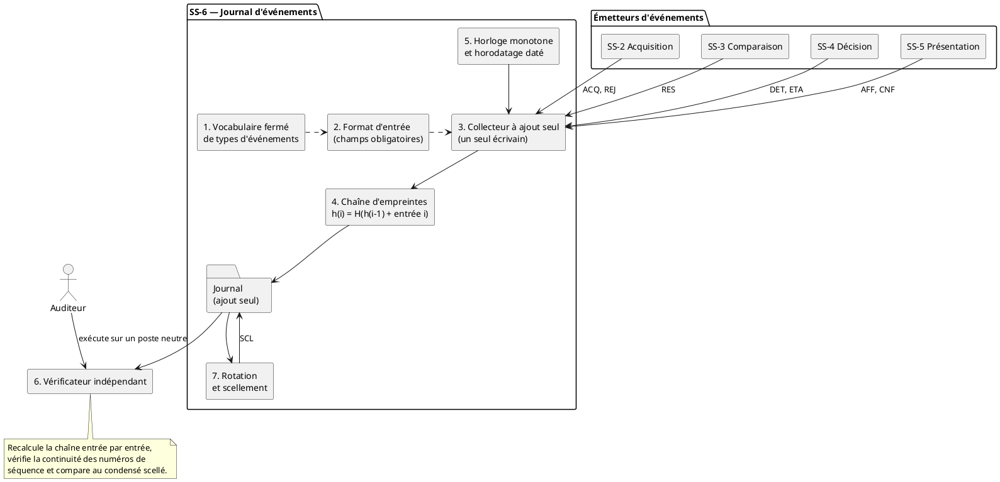

# SS-6, concept A : journal d'événements

**Fonction (tableau 1-4 du plan de projet).** Journaliser, horodater et protéger l'intégrité de la chaîne, de l'acquisition à l'affichage.
**Lot.** L5 · **Auteur.** Christian Kévin Sawadogo · **Réviseur.** à désigner · **Version.** v0.1, 21 octobre 2026

---

## 1. Présentation du concept

Les trois concepts de cette fonction se distinguent par ce que l'on enregistre, donc par ce que l'enregistrement permet de refaire après coup. Le concept B enregistre tous les échantillons et toutes les sorties, ce qui rend le diagnostic rejouable au prix d'une écriture par cycle et par variable. Le concept C combine un flux de données à rétention courte et un journal scellé à rétention longue. Le concept A enregistre **les événements, c'est-à-dire ce qui change et ce qui est décidé**, et non les valeurs qui ont conduit à ces décisions.

Une difficulté doit être levée d'entrée, parce qu'elle décide de la viabilité du concept. L'exigence EX-F-10 demande de journaliser « chaque acquisition », ce qui est littéralement un enregistrement par cycle et ressemble donc au concept B. La réponse de ce concept est une distinction qui n'est pas un contournement mais le cœur de sa conception : **une acquisition est journalisée comme événement à chaque cycle, mais l'entrée porte le fait de l'acquisition, son instant, sa qualification et une empreinte des valeurs, et non les valeurs elles-mêmes.** Le volume reste borné et constant par cycle, la complétude reste démontrable, et l'intégrité aussi.

L'empreinte des valeurs est ce qui donne au concept son argument principal. Le projet dispose déjà, par l'exigence EX-F-02, d'une propriété forte : un même scénario produit deux fois la même trajectoire. Si cette propriété est tenue, alors régénérer les valeurs à partir du scénario et recalculer leur empreinte suffit à prouver que le jeu régénéré est exactement celui qui avait été acquis. **Le concept A récupère ainsi une grande partie de la capacité de rejeu du concept B sans en payer le volume**, en s'appuyant sur une exigence que le projet doit de toute façon satisfaire et vérifier. La contrepartie est claire et doit être écrite : la preuve de rejeu devient conditionnelle à la reproductibilité de SS-1, alors qu'elle est inconditionnelle dans le concept B.

Le second argument du concept est la simplicité de sa vérification. Une entrée porte sa propre preuve, la chaîne se recalcule de bout en bout, et un vérificateur extérieur n'a besoin que du fichier, de l'attestation de scellement et de la clé remise séparément. C'est exactement ce qu'un auditeur demande, et c'est exécutable sur un poste neutre sans installer l'application.

---

## 2. Schéma de la solution

Le schéma situe le module par rapport aux cinq autres sous-systèmes et montre que le vérificateur est un acteur extérieur à la chaîne. Il ne remplace pas le texte des sections 3 et 4, qui donnent le format des entrées et la procédure de vérification.

---

## 3. Description des composantes

**1. Vocabulaire fermé de types d'événements.** Une énumération close : un type absent de la liste ne peut pas être journalisé. Cette fermeture est une disposition de conception volontaire, parce qu'elle oblige à rendre explicite tout nouvel événement au lieu de le glisser dans un champ de texte libre.

| Type | Événement | Charge utile | Exigence et état GEMMA |
|---|---|---|---|
| SES | Ouverture ou fermeture de session | Version du modèle, version de configuration, précision d'horodatage déclarée | A1 |
| ACQ | Une acquisition a eu lieu | Numéro de cycle, codes de qualité par variable, empreinte des valeurs | EX-F-10, F1 |
| REJ | Une donnée a été rejetée et non propagée | Variable, motif du rejet | EX-Q-04, D1 |
| RES | Un écart dépasse le budget d'incertitude | Variable, écart normalisé | F1 |
| DET | Une anomalie est détectée | État, niveau de confiance, variables contributrices | EX-F-10, D2 |
| ETA | Changement d'état | État précédent, nouvel état, condition de transition | EX-F-10, A1 F1 D1 D2 D3 |
| AFF | Ce qui a été affiché au moment d'une décision | État, confiance, hypothèses ou variables présentées | EX-F-09, D3 |
| CNF | Confirmation explicite de l'opérateur | Identifiant, contenu de l'affichage confirmé | EX-F-09, D3 |
| SCL | Scellement périodique | Empreinte courante, numéro de séquence atteint | EX-Q-02 |

**2. Format d'entrée.** Champs obligatoires pour tout type : numéro de séquence strictement croissant, horodatage daté, valeur d'horloge monotone, type, sous-système émetteur, charge utile, empreinte chaînée. Un champ obligatoire absent rend l'entrée invalide, ce qui est détecté à la vérification.

**3. Collecteur à ajout seul.** Un seul écrivain, pour que l'ordre d'écriture soit l'ordre des numéros de séquence sans arbitrage. Chaque entrée est écrite d'un bloc puis synchronisée, de sorte qu'une coupure d'alimentation au mauvais moment produit au pire une dernière ligne incomplète, laquelle est détectée par la chaîne comme ligne finale invalide et non comme une altération du reste.

**4. Chaîne d'empreintes.** Chaque entrée porte l'empreinte de la précédente combinée à son propre contenu. Toute suppression, insertion ou modification d'une entrée rompt la chaîne à partir de ce point et devient détectable sans qu'il soit nécessaire de connaître le contenu attendu.

**5. Horloge.** Deux temps sont enregistrés pour deux usages distincts. L'horloge monotone atteste l'ordre et ne peut pas reculer. L'horodatage daté sert la lisibilité humaine et l'audit. La précision réellement obtenue est déclarée à l'ouverture de session dans l'entrée SES, plutôt que suggérée par un nombre de décimales que rien ne garantit.

**6. Vérificateur indépendant.** Programme distinct de l'application, qui ne dépend que du fichier de journal, de l'attestation de scellement et de la clé remise séparément. C'est le livrable qui rend le concept auditable, et c'est celui sur lequel la revue doit porter en priorité.

**7. Rotation et scellement.** Politique de rotation par fichier, avec émission d'une entrée SCL et conservation du condensé séparément du journal lui-même. Un condensé conservé dans le fichier qu'il protège ne protège rien.

---

## 4. Description du fonctionnement

À l'ouverture de session, le module écrit une entrée SES qui fige la version du modèle, la version de configuration et la précision d'horodatage déclarée. Chaque sous-système émet ensuite ses événements vers le collecteur, qui leur attribue un numéro de séquence, les horodate, calcule l'empreinte chaînée et écrit l'entrée d'un bloc. À intervalle fixé, une entrée SCL fige l'empreinte courante et le numéro de séquence atteint, et ce condensé est conservé hors du journal.

La vérification se déroule en quatre temps, et c'est la procédure qui fait la valeur du concept. Le vérificateur recalcule l'empreinte de chaque entrée à partir de celle de la précédente et de son contenu. Il compare l'empreinte finale au condensé scellé. Il vérifie que les numéros de séquence se suivent sans trou, ce qui est la preuve attendue par EX-Q-02, la méthode étant la continuité stricte de la séquence et jamais l'absence constatée d'erreur. Il vérifie enfin que l'horloge monotone ne recule jamais. Un écart à l'une de ces quatre vérifications localise l'entrée en cause.

Pour retrouver les valeurs qui ont produit une décision, la procédure est celle décrite à la section 1 : régénérer la trajectoire à partir de l'identifiant de scénario consigné dans l'entrée SES, recalculer l'empreinte des valeurs et la comparer à celle portée par l'entrée ACQ du cycle visé.

---

## 5. Limites du concept et points à trancher avec l'équipe

**Ce que la preuve d'intégrité ne couvre pas.** Une empreinte calculée avec une clé symétrique détenue par celui qui écrit prouve l'absence d'altération par un tiers qui n'a pas la clé. Elle ne prouve pas l'absence de réécriture par le producteur lui-même. Cette limite doit figurer noir sur blanc dans le rapport. Pour s'approcher de la non-répudiation, il faudrait signer les entrées de scellement avec une clé détenue par un rôle distinct de celui qui écrit, ce qui renforcerait aussi le principe de séparation des fonctions retenu par l'équipe à la section 6 du plan. C'est un raffinement à soumettre à la revue, pas un quatrième concept.

**Reconstituer n'est pas recalculer.** Sans la régénération par scénario, le journal permet de reconstituer la suite des décisions mais pas de les refaire, et il faut alors croire le système sur parole pour les valeurs. La capacité de rejeu est donc conditionnelle à la tenue d'EX-F-02, ce qui crée une dépendance envers SS-1 qu'il faut déclarer.

**Attribution d'EX-Q-04.** L'exigence demande qu'une donnée non conforme soit rejetée, journalisée et non propagée au modèle, alors que SS-6 est déclaré non-maillon de la chaîne. La répartition proposée est la suivante : SS-6 fournit le journal du rejet par l'entrée REJ, et la non-propagation est exécutée par le maillon appelant. Cette répartition est à confirmer en revue, parce qu'elle touche la frontière entre deux sous-systèmes.

**Paramètres encore ouverts.** La durée D de l'essai d'endurance d'EX-Q-02, la période de scellement et la période de rotation sont à fixer au jalon J2 avec leur justification.

---

## 6. Exigences couvertes

| Exigence | Traitement dans ce concept |
|---|---|
| EX-F-09 | Entrées AFF et CNF, qui attestent de ce qui était affiché au moment de la confirmation. |
| EX-F-10 | Entrées ACQ, DET et ETA, couvrant les états A1, F1, D1, D2 et D3 du GEMMA. |
| EX-Q-01 | Une écriture par cycle au plus, de taille bornée, donc un coût fixe à inscrire au budget de temps. |
| EX-Q-02 | Continuité stricte des numéros de séquence, vérifiée par le vérificateur indépendant. |
| EX-Q-04 | Entrée REJ pour la journalisation du rejet ; la non-propagation reste au maillon appelant. |
