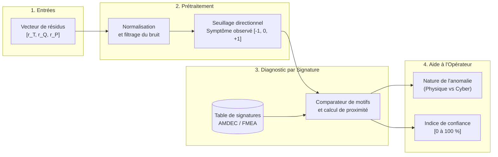
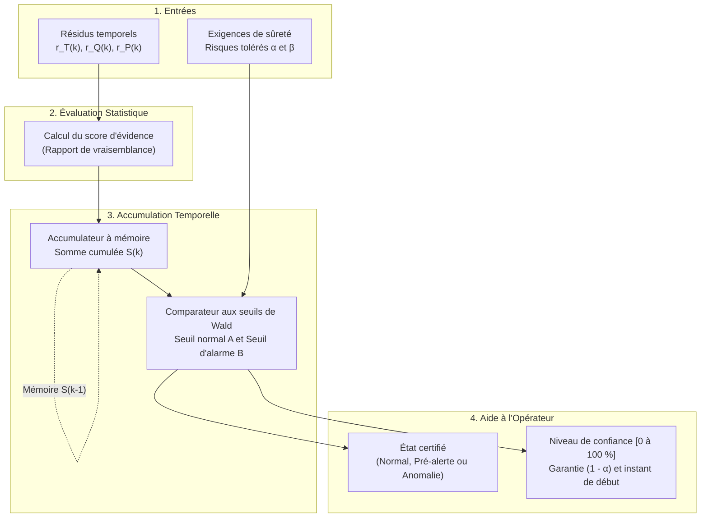

# Documentation Technique — Lot L7 : Détection d'Anomalies et Quantification de l'Incertitude

**Projet :** Jumeau numérique cyberrésilient — Boucle thermohydraulique simplifiée (inspirée du [circuit de caloportage primaire CANDU 6](https://canteach.candu.org/Content%20Library/20044212.pdf) de la centrale [Gentilly-2 d'Hydro-Québec](https://archives.bape.gouv.qc.ca/sections/mandats/gentilly-2/documents/DA22-1.pdf))  
**Fonction technique (Lot L7) :** *« Décider si un résidu traduit une anomalie, et dire avec quelle confiance. »*  
**Cadre normatif :** [CSA N290.7](https://www.csagroup.org/fr/store/product/2428461/) (Cybersécurité nucléaire), [CEI 62645](https://webstore.iec.ch/en/publication/32904) (Sécurité des systèmes d'I&C) et [CEI 62859](https://webstore.iec.ch/en/publication/26131) (Coordination sûreté et cybersécurité).

## 1. Concept 1 : Décision par Signature (Approche Spatiale)

### 1.1 Présentation du concept et réponse au problème

Le concept de **décision par signature** exploite le couplage physique entre les trois variables surveillées de la boucle thermohydraulique : la température ($T$), le débit ($Q$) et la pression ($P$). À chaque instant, le jumeau numérique calcule un vecteur de résidus $\mathbf{r} = [r_T, r_Q, r_P]$ correspondant à l'écart entre les mesures des capteurs et les prédictions du modèle de référence.

Ce concept répond au problème de détection et d'aide à la décision de trois manières complémentaires :
- **Séparation du bruit de mesure :** Chaque résidu est comparé à un seuil de tolérance statique ($\pm \tau$) représentatif du bruit normal d'instrumentation. Tant que les écarts restent dans cette bande morte, l'état est jugé nominal ($0$). Au-delà, la variation est codée selon son sens d'évolution ($+1$ pour une hausse, $-1$ pour une baisse).
- **Distinction entre défaillance physique et cyberattaque :** Le motif observé $[s_T, s_Q, s_P]$ est comparé à une [matrice de signatures défaut-symptôme (FSM)](https://drops.dagstuhl.de/storage/01oasics/oasics-vol136-dx2025/html/OASIcs.DX.2025.15/OASIcs.DX.2025.15.html) établie lors de l'AMDEC (FMEA). En vertu des lois de conservation thermohydrauliques, une anomalie physique réelle affecte simultanément plusieurs variables couplées (ex. une fuite primaire fait chuter la pression et le débit tout en augmentant la température : $[+1, -1, -1]$). Inversement, une cyberattaque par falsification d'un capteur (*spoofing*) ou une panne de sonde génère un écart isolé sur une seule variable (ex. $[+1, 0, 0]$), physiquement incohérent avec le reste de la boucle.
- **Explicabilité et confiance pour l'opérateur :** Conformément à la norme [CEI 62859](https://webstore.iec.ch/en/publication/26131), le système ne déclenche aucune action automatique mais présente à l'opérateur le défaut identifié ainsi qu'un **indice de confiance (0 à 100 %)** proportionnel à l'amplitude de l'écart et à sa correspondance géométrique avec la signature théorique de l'AMDEC.

| Scénario de référence (Table AMDEC) | Température ($s_T$) | Débit ($s_Q$) | Pression ($s_P$) | Interprétation opérationnelle |
| :--- | :---: | :---: | :---: | :--- |
| **État nominal** | $0$ | $0$ | $0$ | Écarts contenus dans la bande de bruit instrumental. |
| **Fuite de réfrigérant (Physique)** | $+1$ | $-1$ | $-1$ | Dépressurisation et baisse de débit entraînant un échauffement. |
| **Défaillance de pompe (Physique)** | $+1$ | $-1$ | $0$ | Chute de débit réduisant le refroidissement à pression régulée. |
| **Encrassement d'échangeur (Physique)** | $+1$ | $0$ | $+1$ | Mauvais transfert thermique et dilatation du fluide à débit constant. |
| **Compromission d'un capteur (Cyber)** | $\pm 1$ | $0$ | $0$ | Variation isolée d'une mesure contredisant l'équilibre physique global. |

### 1.2 Schéma de la solution

Le schéma ci-dessous illustre l'architecture fonctionnelle du Concept 1, depuis l'acquisition des trois résidus jusqu'à l'affichage du diagnostic en salle de commande.

### 1.3 Description des composants et du fonctionnement

#### Description des composants
- **Module de normalisation et de seuillage :** Reçoit les trois résidus bruts, les ramène sur une échelle comparable (en les divisant par l'écart-type du bruit nominal de chaque capteur) et applique les seuils $\pm \tau$ pour produire la signature observée.
- **Base de signatures AMDEC (Mémoire statique) :** Table de correspondance stockant les signatures théoriques des modes de défaillance physiques et cyber identifiés à la conception, protégée en intégrité selon les exigences [CEI 62645](https://webstore.iec.ch/en/publication/32904).
- **Comparateur et calculateur de confiance :** Évalue la concordance entre le vecteur de résidus mesuré et chacune des signatures de la table AMDEC afin de sélectionner le diagnostic le plus probable et d'en quantifier la fiabilité.
- **Interface d'aide à la conduite (IHM) :** Affiche la cause identifiée, les variables en dépassement et le pourcentage de confiance associé.

#### Description du fonctionnement et de l'évaluation de la confiance
À chaque pas de temps, le traitement s'exécute de manière instantanée (sans mémoire des instants précédents) selon quatre étapes :
1. **Qualification de l'écart :** Les résidus $r_T, r_Q, r_P$ sont normalisés. S'ils demeurent tous sous leur seuil de tolérance $\tau$, le système confirme le régime normal.
2. **Génération du vecteur symptôme :** Dès qu'au moins un résidu franchit son seuil, le vecteur directionnel observé est construit.
3. **Appariement AMDEC :** Le comparateur recherche dans la table la signature théorique $\mathbf{S}_j$ qui correspond au motif observé.
4. **Calcul de la confiance :** Le score de confiance (0 à 100 %) est obtenu en multipliant deux critères : **l'intensité du dépassement** (plus les résidus s'éloignent de la zone de bruit, plus la certitude d'une anomalie réelle tend vers 1) et **la qualité d'alignement** (proximité directionnelle entre le vecteur mesuré et la signature théorique). Si un écart fort ne correspond à aucune ligne de la table, le système signale une *anomalie non répertoriée* ([CSA N290.7](https://www.csagroup.org/fr/store/product/2428461/)).

**Forces et limites opérationnelles :** Ce concept offre une détection immédiate sur un défaut franc et une excellente capacité à isoler l'origine physique ou cyber d'une panne. En revanche, comme il prend sa décision sur un seul instant, il reste vulnérable aux pointes de bruit ponctuelles (risque de fausses alertes brèves) et ne peut pas détecter une attaque furtive par dérive lente tant que celle-ci demeure inférieure au seuil $\tau$.

## 2. Concept 2 : Décision Séquentielle (Approche Temporelle)

### 2.1 Présentation du concept et réponse au problème

Le concept de **décision séquentielle** repose sur l'accumulation temporelle de l'information statistique, mise en œuvre par le [test séquentiel du rapport de vraisemblance (SPRT) de Wald](https://www.me.psu.edu/ray/journalAsokRay/1983/020RayDesaiDeyst1983.pdf) ou la [somme cumulée (CUSUM)](https://www.researchgate.net/publication/281567648_The_CuSum_algorithm_-_a_small_review). Plutôt que de conclure sur une mesure isolée, l'algorithme observe la persistance des résidus au fil du temps avant de se prononcer.

Ce concept répond au problème de détection et de maîtrise des risques de la manière suivante :
- **Filtrage rigoureux du bruit et détection des dérives lentes :** En régime normal, le bruit de mesure oscille aléatoirement autour de zéro et ses effets s'annulent dans le temps. À l'inverse, une anomalie naissante ou une cyberattaque furtive (biais léger mais continu sur $T$, $Q$ ou $P$) produit un écart qui s'additionne pas après pas dans un accumulateur jusqu'à devenir statistiquement indiscutable.
- **Maîtrise explicite des risques d'erreur ($\alpha$ et $\beta$) :** Dès la conception, l'ingénieur fixe la probabilité maximale de **fausse alarme ($\alpha$)** et la probabilité maximale de **non-détection ($\beta$)** tolérées par l'analyse de sûreté. Ces deux paramètres déterminent directement le seuil d'alarme $B = \ln((1-\beta)/\alpha)$.
- **Aide à l'opérateur sans fausse alerte intempestive :** Tant que l'indice cumulé n'a pas atteint le seuil $B$, le système indique un état d'accumulation (pré-alerte) sans saturer l'opérateur d'alarmes intempestives ([CEI 62859](https://webstore.iec.ch/en/publication/26131)). Lorsque le seuil $B$ est franchi, l'anomalie est déclarée avec une garantie statistique certifiée $(1-\alpha)$.

### 2.2 Schéma de la solution

Le schéma ci-dessous présente la chaîne fonctionnelle du Concept 2, mettant en évidence la boucle de mémoire temporelle et la comparaison aux seuils garantissant les risques $\alpha$ et $\beta$.

### 2.3 Description des composants et du fonctionnement

#### Description des composants
- **Évaluateur de vraisemblance :** Compare à chaque instant le résidu reçu ($r_T$, $r_Q$ ou $r_P$) à deux hypothèses statistiques : l'hypothèse normale $\mathcal{H}_0$ (bruit centré sur zéro) et l'hypothèse d'anomalie $\mathcal{H}_1$ (présence d'une dérive).
- **Accumulateur temporel (Mémoire d'état) :** Additionne d'un pas de temps à l'autre les scores d'évidence fournis par l'évaluateur afin de conserver l'historique récent de dégradation sur chaque variable de la boucle.
- **Gestionnaire des seuils ($\alpha, \beta$) :** Traduit les exigences de sûreté ($\alpha$ et $\beta$) en deux bornes de décision : une borne basse $A$ confirmant l'état sain (remise à zéro de l'accumulateur) et une borne haute $B$ déclenchant l'alarme.
- **Générateur de confiance et d'horodatage :** Convertit le niveau de remplissage de l'accumulateur en pourcentage de confiance et détermine l'instant exact où la dérive a débuté.

#### Description du fonctionnement et de l'évaluation de la confiance
À chaque pas d'échantillonnage $k$, le traitement suit un cycle séquentiel en quatre étapes :
1. **Calcul de l'incrément d'information :** Pour chaque variable ($T, Q, P$), le module calcule le gain d'évidence apporté par la nouvelle mesure. Si le résidu est proche de zéro, cet incrément est négatif ; s'il présente un écart anormal, l'incrément est positif.
2. **Mise à jour de la mémoire :** L'incrément est ajouté à la somme cumulée précédente $S(k-1)$ pour obtenir $S(k)$ (en maintenant un plancher à zéro lorsque le système est parfaitement sain).
3. **Règle de décision à trois états :**
   - Si $S(k) = 0$ : l'hypothèse normale est retenue, aucune anomalie n'est présente.
   - Si $0 < S(k) < B$ : l'information est encore insuffisante pour trancher avec les risques $(\alpha, \beta)$ exigés ; le système reste en observation (pré-alerte) et poursuit l'accumulation au pas suivant.
   - Si $S(k) \ge B$ : l'anomalie est formellement déclarée.
4. **Calcul de la confiance :** Le niveau de confiance évolue proportionnellement au rapport $S(k)/B$ entre $0\ \%$ (état sain) et $(1-\alpha) \times 100\ \%$ (ex. $99{,}9\ \%$ pour $\alpha = 10^{-3}$) lorsque le seuil $B$ est atteint. L'opérateur dispose ainsi à la fois de la progression en temps réel vers l'alarme et de la certitude statistique finale exigée par la norme [CSA N290.7](https://www.csagroup.org/fr/store/product/2428461/).

**Forces et limites opérationnelles :** Ce concept élimine les fausses alertes dues aux pointes de bruit passagères et excelle dans la détection des cyberattaques furtives ou de l'usure progressive des composants. En contrepartie, l'accumulation introduit un léger délai de confirmation (quelques pas de temps pour une dérive faible) et détecte quelles variables dérivent sans nommer directement le composant défaillant si elle n'est pas couplée à une table de signatures.

## 3. Synthèse Comparative pour le Lot L7

| Critère d'ingénierie | Concept 1 : Décision par Signature | Concept 2 : Décision Séquentielle (SPRT / CUSUM) |
| :--- | :--- | :--- |
| **Logique de décision** | Spatiale et instantanée (comparaison à une table AMDEC). | Temporelle et cumulative (intégration jusqu'au seuil $B$). |
| **Réponse aux sauts francs** | Immédiate (dès le premier dépassement de seuil). | Très rapide (1 à 3 pas de temps). |
| **Réponse aux dérives lentes / cyber furtives** | Limitée (aveugle sous le seuil de bruit statique). | Excellente (cumul progressif des faibles écarts). |
| **Expression de la confiance** | Proximité géométrique avec la signature du défaut. | Garantie statistique bornée par les risques $(\alpha, \beta)$. |
| **Intérêt principal pour l'opérateur** | Explique **la cause** (isole panne physique vs attaque capteur). | Certifie **la fiabilité** de l'alerte et l'instant de début. |
