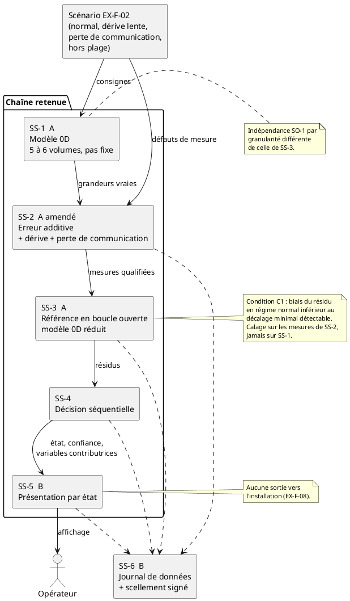

# Choix final des concepts

**Projet.** Jumeau numérique de surveillance d'une boucle thermohydraulique simplifiée, scénario fictif de remise en service de Gentilly-2

**Étape.** Clôture de l'analyse des concepts (atelier 2.2) : cohérence entre fonctions, contraintes, développement durable, analyse de la valeur, décision

**Auteur.** Christian Kévin Sawadogo, chargé de projet · **Réviseur.** à désigner · **Version.** v0.1, 26 octobre 2026

**Statut.** Proposition à ratifier en équipe. Aucune décision de ce document n'est acquise avant ratification.

**Sources.** Les dix-neuf fichiers du dossier `concept_analyse`, la définition des concepts de SS-4 (`lot_l7_detection_anomalies_concepts.md`, branche `main`) et le plan de projet en vigueur sur `main`. Toutes les notes citées sont celles des matrices de l'étape 5 produites par l'équipe. Aucune n'a été modifiée.

---

## 1. Décision proposée

| Fonction | Concept retenu | Par rapport à l'étape 5 | Raison déterminante |
|---|---|---|---|
| SS-1 Simuler la boucle | **A, modèle 0D à paramètres concentrés** | égalité A = B départagée | Aucun scénario du domaine de validité ne demande de résolution spatiale. |
| SS-2 Acquérir, dégrader, qualifier | **A, erreur additive par capteur**, amendé | B devancé | B coûte deux fois plus pour 2,5 points, gagnés sur une dynamique qu'aucune exigence ne demande. A doit recevoir la dérive lente et la perte de communication. |
| SS-3 Comparer à l'attendu | **A, référence en boucle ouverte**, sous condition | confirmé | C'est la seule référence qui ne masque pas une dérive lente, le scénario déterminant. |
| SS-4 Décider et qualifier la confiance | **Décision séquentielle** | confirmé | Seule méthode qui accumule un faible écart persistant, ce que demande la dérive lente. |
| SS-5 Présenter à l'opérateur | **B, présentation par état de la boucle** | confirmé | Consomme exactement ce que SS-4 produit : un état et ses variables contributrices. |
| SS-6 Journaliser et protéger | **B, journal de données, avec le scellement signé de C** | confirmé | Seul concept qui permet de rejouer tout le diagnostic, indépendamment des autres choix. |

La décision séquentielle porte la lettre B dans la grille d'équipe et la lettre C dans la définition de SS-4. Elle est désignée ici par son nom, jusqu'à ce que les étiquettes soient alignées (section 11).

---

## 2. Pourquoi les matrices par fonction ne suffisaient pas

Trois fonctions se jouaient à moins de trois points : SS-1 à égalité, SS-2 à 2,5 points, SS-3 à 1,25 point. À cet écart, la matrice d'une fonction ne départage plus rien, et chaque matrice a été notée isolément, donc aucune ne pouvait voir ce qui se passe à l'interface avec ses voisines.

Deux éléments du plan de projet tranchent là où les notes ne le peuvent pas.

**Le domaine de validité.** Le plan couvre « les scénarios listés à l'exigence EX-F-02, plus les cas de données manquantes », et exclut « tout scénario non listé ». EX-F-02 en liste quatre : le fonctionnement normal, la dérive lente d'un capteur, la perte de communication et la valeur hors plage. Les trois scénarios défaillants portent tous sur la chaîne de mesure. Aucun ne porte sur le procédé.

**L'objectif SO-1.** Le plan exige « un modèle de la boucle et un modèle de référence indépendant, dont l'écart est quantifié ». L'indépendance entre SS-1 et SS-3 est donc un objectif du projet, et non une précaution parmi d'autres.

---

## 3. Le constat qui prime : les scénarios d'EX-F-02 ne sont attribués à aucune fonction

La dérive lente d'un capteur est le scénario sur lequel toute la chaîne de détection a été choisie. Le premier critère de la matrice de SS-4, à 15 %, est la « détection des dérives lentes », et c'est sur lui que la décision séquentielle prend son avance.

Or aucune fonction ne produit ce scénario.

- **SS-1** ne mentionne ni la dérive, ni la perte de communication, ni la valeur hors plage, ni EX-F-02. Ses défaillances portent sur le procédé, ce qui est logique puisque SS-1 produit les grandeurs vraies.
- **SS-2** dégrade les mesures par biais constant, bruit blanc et bruit corrélé pour le concept A, par biais, bruit et quantification pour le concept B, par une erreur bornée pour le concept C. Aucun de ces mécanismes n'est une dérive. Le livrable 27 range même la « dérive longue durée » parmi les défauts non représentés.
- **La perte de communication** n'est nommée dans aucun fichier. Seul un essai « donnée absente » de SS-2 s'en approche.
- **La valeur hors plage** est couverte par SS-2, qui prévoit un essai de saturation et un contrôle de plage.

La campagne d'essais du lot L9 doit documenter un essai par scénario d'EX-F-02. En l'état, deux de ces quatre essais n'auraient rien à exécuter.

**Décision proposée.** Les trois scénarios défaillants d'EX-F-02 sont des défauts de chaîne de mesure. Ils sont attribués à SS-2, qui reçoit deux mécanismes supplémentaires : une dérive lente, soit un biais croissant à partir d'un instant donné, et une perte de communication, soit la suppression des mesures sur un intervalle avec le code de qualité correspondant. SS-1 reste responsable des grandeurs vraies et, à titre facultatif, des défaillances du procédé.

Cette attribution élimine d'emblée le concept C de SS-2. Une dérive est une tendance déterministe dans le temps, alors que le concept C tire l'erreur au hasard dans une enveloppe bornée. Il ne peut pas produire une dérive sans cesser d'être lui-même, et il ne satisfait donc pas EX-F-02.

---

## 4. Cohérence entre fonctions

### 4.1 SS-3 et SS-4 : une incompatibilité, et la condition qui la lève

Les deux choix de l'étape 5, référence en boucle ouverte et décision séquentielle, entrent en conflit. Le fichier de SS-3 écrit, à propos du concept A, qu'« une erreur du modèle de référence peut créer un résidu persistant sans défaillance ». Celui de SS-4 écrit, à propos de la décision séquentielle, qu'elle est prévue pour l'« accumulation de faibles biais persistants ». Un test conçu pour accumuler les petits biais persistants, alimenté par une référence qui en produit dès que le modèle est imparfait, se déclenchera sur l'erreur du modèle et non sur la panne.

La référence recalée, concept B de SS-3, supprime ce biais puisque le recalage l'absorbe. Mais elle absorbe aussi une partie de la dérive qu'il faut détecter, et la matrice de SS-3 lui donne déjà 5 sur 10 pour ce risque de masquage. Comme la dérive lente est précisément le scénario déterminant, le masquage est le défaut le plus grave des deux. **La boucle ouverte est conservée**, à la condition suivante.

> **Condition C1.** En fonctionnement normal, le biais du résidu doit rester inférieur au plus petit décalage que le test séquentiel est réglé pour détecter. Pour y parvenir, la référence de SS-3 est calée sur des essais sans défaut, à partir des seules mesures produites par SS-2, et jamais sur les grandeurs vraies ni sur les paramètres de SS-1.

Le plan prévoit déjà de vérifier, sur le flux entre SS-3 et SS-4, « que l'écart entre les deux modèles reste sous le seuil retenu ». La condition C1 donne une valeur à ce seuil. Si l'essai montre qu'elle ne peut pas être tenue, SS-3 bascule vers la référence recalée (section 10).

### 4.2 SS-1 et SS-3 : l'indépendance par la granularité

SO-1 exige que la référence soit indépendante du simulateur. Deux voies le permettent. La première passe par un SS-1 en 1D, qui rend les deux représentations différentes par construction, mais au prix du maillage. La seconde passe par deux modèles 0D de granularité différente, cinq ou six volumes pour SS-1 et un modèle réduit pour SS-3, calé selon la condition C1. La seconde suffit à SO-1, coûte moins cher, et rien dans le domaine de validité ne réclame la résolution spatiale du 1D.

Le choix de SS-1 tient même si l'équipe conserve les défaillances du procédé. Le fichier de SS-1 montre que le concept A les représente en modifiant « une résistance hydraulique ou un coefficient d'échange ». Seul un défaut **localisé** sur une portion de la boucle exigerait le 1D, et aucune exigence ne le demande.

### 4.3 SS-4 et SS-5 : ce que la présentation consomme

La décision séquentielle produit un état parmi normal, dérive, anomalie et incertain, ainsi que les variables dont le test individuel a franchi sa borne. La présentation par état de la boucle consomme exactement ces deux sorties. Le concept B de SS-5 est donc confirmé.

Le concept C de SS-5, présentation par hypothèse de défaillance, n'est pas viable dans cette architecture. Sa propre définition l'annonçait : il n'est défendable que si une relation physique invariante est disponible en amont, par le concept B de SS-2 ou le concept C de SS-3. Aucun des deux n'est retenu, donc ses symptômes les plus discriminants n'existent pas.

### 4.4 SS-1 et SS-6 : une hypothèse contradictoire, sans effet sur la décision

La matrice de SS-1 donne 10 sur 10 aux trois concepts pour la reproductibilité, à titre d'hypothèse. Celle de SS-6 note le journal d'événements à 25 % pour le recalcul, « tant que SS-1 n'a pas démontré EX-F-02 ». Les deux hypothèses se contredisent.

Le concept A de SS-1 lève la contradiction : un modèle 0D intégré à pas fixe, avec une graine et des versions consignées, produit deux fois la même trajectoire par construction. La décision de SS-6 n'en change pas pour autant, parce que le journal de données domine les deux autres concepts sans dépendre de SS-1 (section 8).

---

## 5. Schéma de l'architecture retenue

Le schéma situe les six concepts retenus et les conditions portées par leurs interfaces. Il ne remplace pas la section 4.

---

## 6. Contraintes de l'architecture retenue

| Type | Contraintes |
|---|---|
| **Physiques** | Boucle simplifiée, écoulement monophasique, modèle 0D. Trois grandeurs seulement, température, pression et débit, dont la suffisance reste une hypothèse du plan (H-09). Capteurs supposés sans dynamique propre, ce qui vaut en régime lent et doit être déclaré comme limite. Ordres de grandeur du circuit caloporteur CANDU 6 utilisés comme cibles de plausibilité et non de validation. |
| **Techniques** | Condition C1 entre SS-3 et SS-4. Indépendance SO-1 par granularité. Reproductibilité exacte : pas fixe, graine et versions consignées. Temps de cycle T encore ouvert, alors que les matrices de SS-5 et de SS-6 supposent des valeurs différentes. Contrat de données commun aux six fonctions. |
| **Économiques** | Enveloppe de 1080 heures, soit 54 000 $ de main-d'œuvre valorisée. Coût de licence nul pour tous les concepts retenus. Aucune estimation en heures n'existe pour SS-1, SS-3, SS-4 et SS-5. |
| **Environnementales** | Aucune incidence matérielle : prototype entièrement simulé, calcul local. Seule empreinte mesurable, le stockage du journal de SS-6, de l'ordre de 0,14 Go par 100 heures à T = 1 s et de 1,4 Go à T = 100 ms. |
| **Sociales** | Usage d'un outil numérique d'aide à la décision en contexte nucléaire, qui pose des questions de confiance et de transparence (EX-C-03). La décision reste humaine. |
| **Humaines** | La présentation par état expose au biais d'automatisation : l'opérateur peut se fier à l'état sans vérifier. La parade retenue est l'accès aux variables contributrices en un clic. Le passage en mode dégradé exige une confirmation explicite journalisée (EX-F-09). |
| **Légales** | Prototype académique, scénario fictif, aucun raccordement à une installation réelle (EX-C-02). Normes de cybersécurité nucléaire appliquées dans leur esprit, hors de leur domaine d'application déclaré, comme le prévoit la section 6 du plan. |

---

## 7. Développement durable

L'atelier assigne à cette analyse un objectif précis : démontrer le choix de la solution finale. Elle compare donc l'architecture retenue aux solutions écartées, pilier par pilier.

| Pilier | Ce qui distingue l'architecture retenue | Départage-t-il ? |
|---|---|---|
| **Environnemental** | Tous les concepts sont logiciels et calculés localement. Le journal de données stocke davantage que le journal d'événements, et le 1D calcule davantage que le 0D, mais les deux écarts sont négligeables à cette échelle. | Non. Il faut le dire plutôt que forcer un argument. |
| **Économique** | C'est l'architecture cohérente la moins coûteuse : pas de maillage pour SS-1, 36 heures de moins pour SS-2. Les heures libérées vont au lot L9, dont la campagne d'essais doit démontrer la suffisance du modèle, risque surveillé par RT4. | **Oui**, nettement. |
| **Social** | C'est la combinaison la plus vérifiable parmi celles évaluées. La référence en boucle ouverte ne peut pas apprendre à ignorer une panne. L'état affiché remonte à ses variables en un clic. Le journal de données permet à un tiers de rejouer tout le diagnostic, et le scellement signé sépare celui qui écrit de celui qui atteste. | **Oui**. C'est l'argument le plus fort pour EX-C-03. |

**Contexte social, politique et socioéconomique.** La remise en service d'une centrale nucléaire fermée, même dans un scénario fictif, est un sujet public sensible. La réponse du projet n'est pas d'annoncer des performances, que rien ne démontre encore, mais de rendre ses limites visibles : domaine de validité déclaré (EX-C-01), état incertain affiché plutôt qu'un état normal présumé (EX-F-06), diagnostic rejouable par un tiers.

---

## 8. Analyse de la valeur

L'atelier définit la valeur comme le rapport entre la satisfaction des besoins et la consommation de ressources. La satisfaction est prise ici dans les notes de l'étape 5 et la ressource dans les estimations en heures de l'équipe. Le calcul n'est possible que pour les deux fonctions qui ont chiffré leurs efforts.

**SS-2.**

| Concept | Note | Effort | Ce que rapporte le passage au concept suivant |
|---|:-:|:-:|---|
| C, enveloppe | 75 % | 28 h | éliminé par EX-F-02 (section 3) |
| A, erreur additive | 82,5 % | 36 h | de C à A : 8 h pour 7,5 points, soit environ 0,9 point par heure |
| B, chaîne physique | 85 % | 72 h | de A à B : 36 h pour 2,5 points, soit environ 0,07 point par heure |

Le passage de A à B rapporte treize fois moins par heure que le passage de C à A. C'est le cas typique que l'analyse de la valeur doit repérer : un effort important pour une satisfaction marginale. De plus, ces 2,5 points viennent du critère « dynamique des mesures », qu'aucune exigence ne demande, et une dynamique de capteur que la référence de SS-3 ne modélise pas apparaîtrait dans le résidu à chaque transitoire. L'amendement de A, dérive et perte de communication, reste à chiffrer par le lot L6. Il ne s'agit que de deux termes supplémentaires dans un modèle additif.

**SS-6.**

| Concept | Note | Effort |
|---|:-:|:-:|
| B, journal de données | 89,25 % | 40 h |
| C, deux niveaux | 82,5 % | 80 h |
| A, journal d'événements | 69,25 % | 40 h |

B domine les deux autres sans discussion : même effort que A pour vingt points de plus, moitié moins d'effort que C pour près de sept points de plus. L'ajout du scellement signé coûte environ 20 heures pour à peine trois points. **La valeur ne le justifie pas, c'est l'exigence qui le justifie** : la séparation des fonctions est l'un des quatre principes de cybersécurité que l'équipe s'est imposés à la section 6 du plan.

**Lacune.** SS-1, SS-3, SS-4 et SS-5 n'ont pas estimé leur effort en heures. Leurs critères d'effort notés sur 10 indiquent une tendance, sans permettre le calcul. Pour SS-3, la boucle ouverte est jugée plus simple que la référence recalée (7,5 contre 5). Pour SS-4, la décision séquentielle est jugée la plus simple des trois (10 contre 5 et 7,5).

---

## 9. Synthèse et discussion

| Fonction | Étape 5 | Cohérence entre fonctions | Valeur | Décision |
|---|---|---|---|---|
| SS-1 | A 81,25 = B 81,25, C 65 | A et B satisfont SO-1, aucune exigence ne demande le 1D | A moins coûteux, sans maillage | **A** |
| SS-2 | B 85, A 82,5, C 75 | C ne produit pas de dérive, il est éliminé | de A à B, 0,07 point par heure | **A amendé** |
| SS-3 | A 86,25, B 85, C 67,5 | A compatible avec SS-4 sous C1, B masque la dérive | A plus simple | **A sous C1** |
| SS-4 | séquentielle 91,25, signature 77,5, budget 73,75 | seule à accumuler un écart persistant | jugée la plus simple | **séquentielle** |
| SS-5 | B 96,25, C 81,25, A 73,75 | C privé de ses symptômes dans cette architecture | non chiffré | **B** |
| SS-6 | B 89,25, C 82,5, A 69,25 | indépendant des autres choix | B domine | **B avec sceau signé** |

Les notes de SS-5 ont été calculées à partir des pointages de la matrice de l'équipe, dont les totaux sont des formules que le fichier n'avait pas encore évaluées.

Deux décisions s'écartent du classement de l'étape 5. **SS-1** n'en contredit aucun, puisqu'il départage une égalité. **SS-2** inverse l'ordre de A et B. Ce n'est pas une remise en cause du travail du lot L6, dont la matrice qualifiait elle-même l'écart de « fragile » et notait que B tomberait à égalité avec A au-delà de 80 heures. C'est l'effet attendu des étapes que l'atelier place après l'étape 5 : l'exigence EX-F-02 élimine C, et l'analyse de la valeur départage A et B.

Le choix de SS-4 reste incomplet. La définition de SS-4 associe deux tests séquentiels distincts, le test du rapport de probabilité séquentiel et la somme cumulée, et la matrice de l'équipe demande elle-même de « justifier le test retenu et ses seuils ». Le décalage minimal détectable de la condition C1 découle de ce choix.

---

## 10. Conditions de remise en cause

Le choix final est itératif, comme le rappelle l'atelier. Chaque décision fragile est donc assortie de la mesure qui la rouvrirait.

| Si l'on constate que | Alors |
|---|---|
| le biais du résidu en régime normal dépasse le décalage minimal détectable, malgré le calage | SS-3 bascule vers la référence recalée, en acceptant le masquage partiel, et l'on vérifie que la dérive reste détectable à travers l'innovation |
| l'équipe exige des défaillances du procédé **localisées** sur une portion de boucle | SS-1 bascule vers le modèle 1D |
| l'amendement de SS-2 coûte plus que la différence d'effort entre A et B | la comparaison entre A et B est refaite, avec la dérive et la perte de communication ajoutées aux deux concepts |

---

## 11. Corrections à apporter aux livrables

| Gravité | Correction | Responsable |
|---|---|---|
| Bloquante | Ajouter à SS-2 la dérive lente et la perte de communication, et retirer la dérive de la liste des défauts non représentés | lot L6 |
| Bloquante | Aligner les étiquettes de SS-4 : la grille d'équipe nomme B la décision séquentielle, sa définition la nomme C | lot L7 |
| Importante | Fixer le temps de cycle T. La matrice de SS-5 reprend 1 s, celle de SS-6 suppose 100 ms. Proposition : 1 s, ce qui donne une dizaine de points par constante de temps thermique si celle-ci est de l'ordre de la dizaine de secondes, à vérifier sur le modèle de SS-1 | chargé de projet |
| Importante | Ramener à une seule la grille d'étape 4 de SS-5 et de SS-6. Les grilles du dossier `Analyse-des_concepts` n'ont pas servi à l'étape 5 et sont à retirer | chargé de projet |
| Importante | Reconsidérer le poids de 40 % que SS-1 accorde aux défaillances du procédé, situées hors du domaine de validité | lot L4 |
| Importante | Définir les concepts B et C de SS-6, évalués sans avoir été définis | lot L5 |
| Mineure | Garder une seule version de la définition des concepts de SS-5, qui existe en trois versions différentes | lot L8 |
| Mineure | Renommer `Analyse_qualitative_faisabilite_fonction` et `..._initiale`, qui portent sur SS-2 et SS-1 et non sur deux versions d'un même document | lots L4 et L6 |
| Mineure | Compléter l'étape de faisabilité pour SS-5 et SS-6, et pour les concepts manquants de SS-3 et SS-4 | lots L5, L7, L8 |

---

## 12. Prochaine étape : un essai de cohérence

La condition C1 est la seule hypothèse dont dépend l'architecture entière, et elle ne se démontre pas par un document. Elle se mesure sur un prototype vertical réduit au strict nécessaire : SS-1 A, SS-2 A amendé, SS-3 A, et la décision séquentielle, sur les quatre scénarios d'EX-F-02.

| Mesure | Critère de réussite |
|---|---|
| Biais du résidu sur un essai sans défaut | inférieur au décalage minimal détectable (C1) |
| Fausses alarmes sur un essai normal de durée D | aucune |
| Délai de détection de la dérive lente | à consigner, puis comparer au délai visé |
| Bascule en état incertain sur perte de communication | au plus N cycles après le début de la perte |
| Rejet d'une valeur hors plage | rejetée, journalisée, non propagée (EX-Q-04) |

Si l'essai réussit, l'architecture est confirmée avec des chiffres plutôt qu'avec des hypothèses, ce qui est précisément ce qui manque aux matrices de l'étape 5. S'il échoue sur C1, la section 10 dit quoi changer. Dans les deux cas, l'information arrive avant le gel des fonctionnalités du jalon J3, le 20 novembre.
