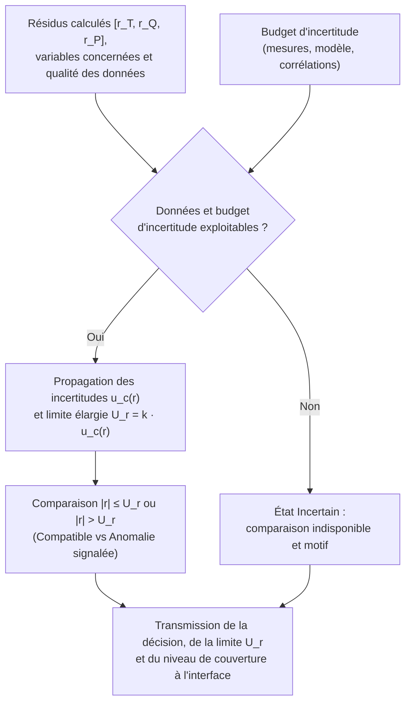
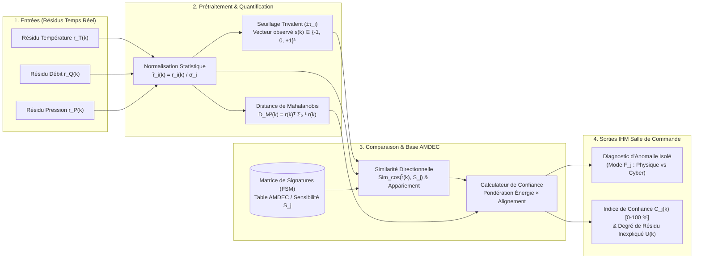
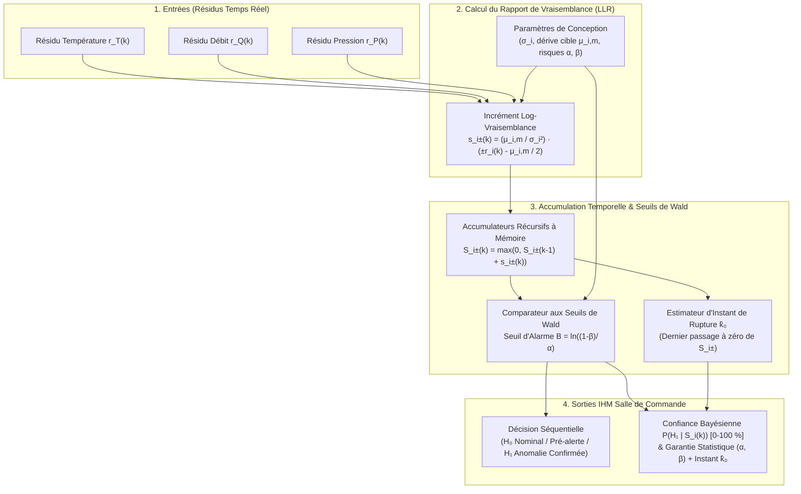

# Documentation Technique Complète — Lot L7 : Détection d'Anomalies et Quantification de l'Incertitude

**Projet :** Jumeau numérique cyberrésilient — Boucle thermohydraulique simplifiée (inspirée du [circuit de caloportage primaire CANDU 6](https://canteach.candu.org/Content%20Library/20044212.pdf) de la centrale [Gentilly-2 d'Hydro-Québec](https://archives.bape.gouv.qc.ca/sections/mandats/gentilly-2/documents/DA22-1.pdf))  
**Fonction technique (Lot L7) :** *« Décider si un résidu traduit une anomalie, et dire avec quelle confiance. »*  
**Référentiels normatifs :** [CSA N290.7](https://www.csagroup.org/fr/store/product/2428461/) (Cybersécurité pour les installations nucléaires), [CEI 62645](https://webstore.iec.ch/en/publication/32904) (Exigences pour les programmes de sécurité des systèmes d'I&C) et [CEI 62859](https://webstore.iec.ch/en/publication/26131) (Coordination entre la sûreté et la cybersécurité).

## 1. Contexte d'Ingénierie et Modélisation des Résidus

À chaque pas d'échantillonnage $k$ ($\Delta t$ fixe), le jumeau numérique compare les mesures issues de l'instrumentation physique $\mathbf{y}(k)$ aux prédictions du modèle thermohydraulique de référence $\hat{\mathbf{y}}(k)$ afin de générer le vecteur de résidus bruts $\mathbf{r}(k) \in \mathbb{R}^3$ :

$$\mathbf{r}(k) = \mathbf{y}(k) - \hat{\mathbf{y}}(k) = \begin{bmatrix} r_T(k) \\ r_Q(k) \\ r_P(k) \end{bmatrix} = \begin{bmatrix} T_{\text{mes}}(k) - T_{\text{mod}}(k) \\ Q_{\text{mes}}(k) - Q_{\text{mod}}(k) \\ P_{\text{mes}}(k) - P_{\text{mod}}(k) \end{bmatrix}$$

En régime nominal sans défaillance ni attaque ($\mathcal{H}_0$), le vecteur de résidus est assimilé à un bruit blanc gaussien centré de matrice de covariance $\mathbf{\Sigma}_0 = \text{diag}(\sigma_T^2, \sigma_Q^2, \sigma_P^2)$, représentatif des incertitudes de mesure et de modélisation. Conformément à la norme [CEI 62859](https://webstore.iec.ch/en/publication/26131), le module du Lot L7 agit exclusivement en boucle ouverte consultative : il n'émet aucune commande directe vers les actionneurs et fournit à l'opérateur de salle de commande un diagnostic explicable assorti d'un niveau de confiance rigoureusement quantifié.

## 2. Concept A : Décision par Budget d'Incertitude (Approche Métrologique NIST)

### 2.1 Présentation du concept et réponse au besoin

Ce concept consiste à comparer chaque résidu $r_i(k)$ ($i \in \{T, Q, P\}$) à une limite calculée à partir des incertitudes connues. Le budget d'incertitude recense les contributions susceptibles d'expliquer un écart en fonctionnement normal : incertitude des capteurs, tolérances sur les paramètres physiques, approximations du modèle thermohydraulique et erreurs de traitement numérique.

L'objectif est d'éviter qu'un petit écart explicable par l'imperfection des capteurs ou du modèle soit systématiquement interprété comme une anomalie. À l'inverse, un résidu dépassant la limite retenue indique une incompatibilité physique ou métrologique avec le comportement attendu, compte tenu du budget établi.

Les différentes sources d'incertitude sont propagées jusqu'au résidu par la loi de propagation des variances pour obtenir une incertitude-type composée $u_c(r_i)$. Une incertitude élargie $U_{r,i}$ est ensuite définie par :

$$U_{r,i} = k_{\text{couv}} \cdot u_c(r_i)$$

où $k_{\text{couv}}$ est un facteur de couverture choisi et justifié (typiquement $k_{\text{couv}} = 2$ pour un niveau de confiance d'environ $95\ \%$ ou $k_{\text{couv}} = 3$ pour $99{,}7\ \%$ sous hypothèse gaussienne). Cette construction suit le principe de combinaison et d'élargissement des incertitudes décrit par le [NIST (Technical Note 1297)](https://www.nist.gov/pml/nist-technical-note-1297/nist-tn-1297-6-expanded-uncertainty). Les corrélations entre contributions doivent être prises en compte lorsqu'elles existent. L'utilisation de $U_{r,i}$ comme limite de décision constitue ici un choix de conception à valider par les essais.

### 2.2 Schéma de la solution

### 2.3 Description des composants et du fonctionnement détaillé

#### Composants clés du module logiciel

| Composant | Rôle fonctionnel |
| :--- | :--- |
| **Réception des résidus** | Recevoir les écarts calculés ($r_T, r_Q, r_P$), les variables concernées et les indicateurs de qualité des données. |
| **Budget d'incertitude** | Recenser les contributions élémentaires (capteurs, modèle, numérique), leurs valeurs, leur origine et leurs éventuelles corrélations. |
| **Calculateur d'incertitude** | Propager les contributions pour obtenir une incertitude-type $u_c(r_i)$ et la limite élargie $U_{r,i}$ dans la même unité physique que le résidu ($^\circ\text{C}$, $\text{kg/s}$, $\text{kPa}$). |
| **Module de décision** | Comparer la valeur absolue du résidu $\vert r_i \vert$ à la limite retenue $U_{r,i}$ et produire le résultat. |
| **Gestion de l'incertitude** | Suspendre la conclusion et forcer l'état *Incertain* lorsque les données d'entrée ou le budget ne permettent pas une comparaison fiable. |
| **Explication du résultat** | Fournir à l'opérateur la valeur du résidu, la limite $U_{r,i}$, les variables impliquées et les conditions de validité. |

#### Déroulement séquentiel du traitement pas-à-pas
1. **Étape 1 — Vérification d'exploitabilité :** Le système reçoit un résidu $r_i(k)$ et vérifie que les mesures ayant servi à son calcul sont valides et horodatées.
2. **Étape 2 — Sélection du budget :** Il sélectionne le budget d'incertitude correspondant à la relation physique ($T, Q$ ou $P$) et au point de fonctionnement courant de la boucle.
3. **Étape 3 — Calcul de la limite :** Il calcule l'incertitude composée $u_c(r_i)$ et la limite de décision élargie $U_{r,i} = k_{\text{couv}} \cdot u_c(r_i)$.
4. **Étape 4 — Règle de décision et transmission :** Il applique la règle ci-dessous et transmet la décision ainsi que sa justification à l'interface, sans commander la boucle ([CEI 62859](https://webstore.iec.ch/en/publication/26131)).

| Condition | Résultat |
| :--- | :--- |
| **Données ou budget non exploitables** | **Incertain :** aucune conclusion fiable possible (test suspendu). |
| **$\vert r_i(k) \vert \le U_{r,i}$** | **Compatible avec les incertitudes :** aucune anomalie mise en évidence par ce test. |
| **$\vert r_i(k) \vert > U_{r,i}$** | **Anomalie signalée :** écart non expliqué par le budget d'incertitude retenu. |

#### Exemple illustratif
Supposons qu'un résidu de pression $r_P$ possède une limite de décision $U_{r,P} = 5\text{ kPa}$ (obtenue avec $u_c(r_P) = 2{,}5\text{ kPa}$ et un facteur de couverture $k_{\text{couv}} = 2$ validé par les essais) :
- Un résidu de $3\text{ kPa}$ ($\vert r_P \vert \le 5\text{ kPa}$) reste compatible avec les incertitudes connues.
- Un résidu de $8\text{ kPa}$ ($\vert r_P \vert > 5\text{ kPa}$) dépasse la limite et déclenche un signalement d'anomalie.
- Si une mesure nécessaire au calcul manque ou est hors gamme, le résultat devient **Incertain**.

### 2.4 Expression de la confiance, limites et analyse critique

- **Interprétation métrologique de la confiance :** L'interface présente le résidu, son incertitude élargie $U_{r,i}$ et le niveau de couverture associé (ex. $95\ \%$ pour $k_{\text{couv}} = 2$ selon le [NIST TN 1297](https://www.nist.gov/pml/nist-technical-note-1297/nist-tn-1297-appendix-b-coverage-factors)). Un intervalle de couverture à $95\ \%$ ne signifie pas que le diagnostic est vrai à $95\ \%$ : il quantifie la bande dans laquelle le résidu doit se situer en l'absence d'anomalie sous les hypothèses du budget.
- **Compromis de réglage et sensibilité :** Un budget sous-estimé ($U_{r,i}$ trop faible) provoque des fausses alertes au moindre bruit ; un budget surévalué ($U_{r,i}$ trop large) masque des anomalies réelles ou des cyberattaques furtives d'amplitude inférieure à $U_{r,i}$.
- **Conformité sûreté ([CSA N290.7](https://www.csagroup.org/fr/store/product/2428461/) / [CEI 62859](https://webstore.iec.ch/en/publication/26131)) :** L'approche garantit une traçabilité physique totale de chaque seuil et protège l'opérateur contre les conclusions erronées grâce à l'état explicite *Incertain* lorsque les données sont dégradées.

## 3. Concept B (Concept 1) : Décision par Signature (Approche Spatiale AMDEC / FSM)

### 3.1 Présentation du concept et réponse au besoin

#### Principe fondamental et formulation mathématique/logique
Le concept de décision par signature repose sur le couplage multiphysique des équations de conservation (masse, quantité de mouvement, enthalpie) régissant la boucle thermohydraulique. Toute défaillance physique ou falsification de capteur projette une empreinte directionnelle spécifique dans l'espace tridimensionnel des résidus $\mathbf{r}(k) = [r_T(k), r_Q(k), r_P(k)]^\top$, formalisée à la conception au sein d'une [Matrice de Signatures de Défauts (FSM)](https://drops.dagstuhl.de/storage/01oasics/oasics-vol136-dx2025/html/OASIcs.DX.2025.15/OASIcs.DX.2025.15.html) issue de l'AMDEC (FMEA) et des relations de redondance analytique (ARR).

À chaque instant $k$, chaque composante $r_i(k)$ ($i \in \{T, Q, P\}$) est normalisée par son écart-type nominal $\sigma_i$ (ou sa limite $U_{r,i}$), puis quantifiée selon une logique trivalente (codage directionnel signé) :

$$s_i(k) = \begin{cases} +1 & \text{si } r_i(k) > +\tau_i \\ 0 & \text{si } \vert r_i(k) \vert \le \tau_i \\ -1 & \text{si } r_i(k) < -\tau_i \end{cases} \quad \text{et} \quad \tilde{r}_i(k) = \frac{r_i(k)}{\sigma_i}$$

où $\tau_i = \kappa \sigma_i$ (typiquement $\kappa = 3$). Le vecteur d'état observé $\mathbf{s}(k) = [s_T(k), s_Q(k), s_P(k)]^\top$ (ainsi que sa version continue normalisée $\tilde{\mathbf{r}}(k)$) est comparé aux $M$ vecteurs colonnes théoriques $\mathbf{S}_j = [S_{T,j}, S_{Q,j}, S_{P,j}]^\top$ de la matrice $\mathbf{M}_{\text{FSM}}$ associée aux modes de défaillance répertoriés $F_j$.

#### Traitement spécifique des variables de la boucle (Température $T$, Débit $Q$, Pression $P$)
La matrice de sensibilité exploite directement la cohérence thermodynamique entre $T$, $Q$ et $P$ pour isoler l'origine physique ou cyber de l'écart :

| Code Défaut | Scénario d'anomalie (Physique ou Cyber) | Signature $S_T$ ($r_T$) | Signature $S_Q$ ($r_Q$) | Signature $S_P$ ($r_P$) | Justification physique / analytique |
| :--- | :--- | :---: | :---: | :---: | :--- |
| **$F_0$** | Régime nominal (absence d'anomalie) | $0$ | $0$ | $0$ | Fluctuations aléatoires bornées dans la bande morte $\pm \tau_i$. |
| **$F_1$** | Perte de réfrigérant primaire (fuite / brèche LOCA) | $+1$ | $-1$ | $-1$ | Dépressurisation rapide ($r_P < 0$), baisse du débit ($r_Q < 0$) et échauffement ($r_T > 0$). |
| **$F_2$** | Dégradation / cavitation de pompe primaire | $+1$ | $-1$ | $0$ | Chute du débit volumique ($r_Q < 0$) réduisant l'extraction thermique ($r_T > 0$) à pression régulée. |
| **$F_3$** | Encrassement / perte de puits froid (échangeur) | $+1$ | $0$ | $+1$ | Hausse de température primaire ($r_T > 0$) induisant une dilatation thermique ($r_P > 0$) à débit constant. |
| **$F_4$** | Cyberattaque par injection sur capteur $T$ (*Spoofing* $T$) | $\pm 1$ | $0$ | $0$ | Écart isolé sur $r_T$ violant le couplage enthalpique avec $Q$ et $P$ demeurés nominaux. |
| **$F_5$** | Cyberattaque par injection sur capteur $Q$ (*Spoofing* $Q$) | $0$ | $\pm 1$ | $0$ | Écart isolé sur $r_Q$ sans répercussion sur le bilan thermique $T$ ni sur la perte de charge $P$. |
| **$F_6$** | Cyberattaque par injection sur capteur $P$ (*Spoofing* $P$) | $0$ | $0$ | $\pm 1$ | Écart isolé sur $r_P$ contredisant l'état thermodynamique observé sur $T$ et $Q$. |

#### Séparation bruit vs anomalie et explicabilité envers l'opérateur de conduite
- **Séparation bruit vs anomalie physique/cyber :** Le bruit d'instrumentation est filtré par la zone morte $[-\tau_i, +\tau_i]$ et par l'évaluation de l'énergie globale du résidu via la distance de Mahalanobis $D_M^2(k) = \sum_{i \in \{T,Q,P\}} \tilde{r}_i(k)^2$. Une anomalie physique affecte simultanément au moins deux variables couplées selon les lois de conservation ($F_1, F_2, F_3$), tandis qu'une cyberattaque mono-capteur ou un biais de sonde génère une signature unitaire orthogonale aux lois physiques ($F_4, F_5, F_6$).
- **Explicabilité opérateur :** L'opérateur visualise instantanément sur son IHM la juxtaposition du vecteur mesuré $[s_T, s_Q, s_P]$ et de la ligne correspondante de l'AMDEC. La justification est transparente (« *Alerte $F_2$ : Hausse de température combinée à une baisse de débit à pression stable* »), éliminant tout effet « boîte noire ».

### 3.2 Schéma de la solution

### 3.3 Description des composants et du fonctionnement détaillé

#### Composants clés du module logiciel

| Composant | Rôle fonctionnel et paramètres |
| :--- | :--- |
| **Réception et Normalisation (`ResidualNormalizer`)** | Regrouper les trois résidus $[r_T, r_Q, r_P]$, vérifier leur simultanéité et les diviser par les écarts-types nominaux $\boldsymbol{\sigma} = [\sigma_T, \sigma_Q, \sigma_P]^\top$. |
| **Générateur de Symptômes (`SymptomQuantizer`)** | Appliquer les seuils $\pm \tau_i$ avec une bande d'hystérésis $\delta_i$ ($0{,}2\,\sigma_i$) anti-bagottement pour produire le vecteur trivalent $\mathbf{s}(k) \in \{-1, 0, +1\}^3$. |
| **Matrice de Signatures (`FSM_Repository`)** | Table statique en mémoire protégée par contrôle d'intégrité CRC-32 ([CEI 62645](https://webstore.iec.ch/en/publication/32904)) stockant les vecteurs théoriques $\mathbf{S}_j$ de l'AMDEC. |
| **Moteur d'Appariement (`SignatureMatcher`)** | Comparer le vecteur observé aux signatures $\mathbf{S}_j$ et calculer la similarité angulaire $\mathcal{A}_j(k) = \cos(\theta_j)$. |
| **Gestion des cas non résolus** | Signaler un état *Incertain* (si un capteur est en défaut de communication) ou une *Anomalie non répertoriée* $U(k)$ (si le motif ne correspond à aucun $\mathbf{S}_j$). |
| **Explication du résultat (IHM)** | Afficher la signature observée, le mode $F_j$ identifié, le score de confiance $C_j(k)$ ($0\text{–}100\ \%$) et la justification physique. |

#### Déroulement séquentiel du traitement pas-à-pas (à chaque pas de temps $k$)
1. **Étape 1 — Acquisition et validation d'intégrité :** Réception du triplet $\mathbf{r}(k) = [r_T(k), r_Q(k), r_P(k)]^\top$ et vérification de la validité des trois capteurs.
2. **Étape 2 — Normalisation adimensionnelle :** Calcul de $\tilde{r}_i(k) = r_i(k)/\sigma_i$ pour ramener les trois grandeurs ($^\circ\text{C}$, $\text{kg/s}$, $\text{MPa}$) sur une échelle statistique commune.
3. **Étape 3 — Test d'énergie et génération du symptôme :** Calcul de l'énergie globale $D_M^2(k) = \sum \tilde{r}_i(k)^2$ et codage du vecteur $\mathbf{s}(k) \in \{-1, 0, +1\}^3$.
4. **Étape 4 — Appariement directionnel et décision :** Évaluation pour chaque mode $F_j$ de la similarité cosinus restreinte au demi-espace positif :
   $$\mathcal{A}_j(k) = \max\left(0, \frac{\tilde{\mathbf{r}}(k)^\top \mathbf{S}_j}{\|\tilde{\mathbf{r}}(k)\|_2 \cdot \|\mathbf{S}_j\|_2}\right) \in [0, 1]$$

| Condition | Résultat |
| :--- | :--- |
| **Une ou plusieurs mesures indisponibles** | **Incertain :** vecteur de résidus incomplet, isolation par signature suspendue. |
| **$\mathbf{s}(k) = [0, 0, 0]$ et $D_M^2(k) < \chi_{3, 1-\alpha}^2$** | **Compatible avec l'état nominal ($F_0$) :** aucun dépassement significatif. |
| **$\mathbf{s}(k) = \mathbf{S}_j$ (signature répertoriée)** | **Anomalie identifiée ($F_j$) :** défaut physique ($F_1\text{–}F_3$) ou anomalie cyber/capteur ($F_4\text{–}F_6$) isolé avec confiance $C_j(k)$. |
| **$\mathbf{s}(k) \neq [0, 0, 0]$ et $\mathbf{s}(k) \notin \{\mathbf{S}_j\}$** | **Anomalie non répertoriée :** écart énergétique fort dont la direction ne correspond à aucun mode connu (défaut multiple ou attaque coordonnée). |

#### Méthode mathématique exacte pour calculer le score de confiance (0 à 100 %)
Pour éviter qu'un résidu de faible amplitude mais fortuitement aligné avec une signature ne génère une confiance proche de $100\ \%$, le score de confiance combine deux facteurs multiplicatifs :
1. **La probabilité d'existence d'une anomalie $\mathcal{P}_{\text{anom}}(k) = F_{\chi_3^2}(D_M^2(k)) \in [0, 1]$**, issue de la fonction de répartition de la loi du $\chi^2$ à $3$ degrés de liberté évaluée sur l'énergie globale du résidu.
2. **La pureté d'alignement directionnel $\mathcal{A}_j(k)^2 = \cos^2(\theta_j) \in [0, 1]$**, mesurant la part de l'énergie du résidu expliquée par la direction propre de la signature $\mathbf{S}_j$.

$$C_j(k) = 100 \times F_{\chi_3^2}\!\left(D_M^2(k)\right) \times \left[\max\left(0, \frac{\tilde{\mathbf{r}}(k)^\top \mathbf{S}_j}{\|\tilde{\mathbf{r}}(k)\|_2 \, \|\mathbf{S}_j\|_2}\right)\right]^2 \quad [\%]$$

Un **indice de résidu inexpliqué** $U(k) = 100 \times F_{\chi_3^2}(D_M^2(k)) \times (1 - \max_j \mathcal{A}_j(k)^2)$ est affiché conjointement pour alerter l'opérateur en cas de mode non répertorié.

#### Exemple illustratif
Supposons que les seuils normalisés soient fixés à $\tau_i = 3\sigma_i$ :
- Si les résidus normalisés valent $\tilde{\mathbf{r}} = [+4{,}2, \, -3{,}9, \, +0{,}2]^\top$, le vecteur trivalent vaut $\mathbf{s} = [+1, -1, 0]$, ce qui correspond exactement à la signature $\mathbf{S}_2$ (*Dégradation de pompe primaire*). Avec $D_M^2 = 32{,}9$ ($F_{\chi_3^2} \approx 1$) et $\mathcal{A}_2^2 = 0{,}997$, le système affiche : **« Anomalie $F_2$ (Pompe primaire) — Confiance : $99{,}7\ \%$ »**.
- Si $\tilde{\mathbf{r}} = [+4{,}5, \, +0{,}1, \, -0{,}1]^\top$, le vecteur $\mathbf{s} = [+1, 0, 0]$ isole la signature $\mathbf{S}_4$ (*Anomalie / Spoofing capteur Température*) avec une confiance de $99{,}9\ \%$.

### 3.4 Analyse critique (Forces, Faiblesses et conformité sûreté)

- **Robustesse face au bruit de mesure et aux cyberattaques :**
  - *Saut brutal (défaut franc ou attaque par échelon) :* Excellente réactivité ; dès que l'amplitude franchit le seuil $3\sigma$, l'isolation entre défaut physique multiphysique ($F_1\text{–}F_3$) et cyberattaque mono-capteur ($F_4\text{–}F_6$) est immédiate.
  - *Falsification lente (attaque furtive en rampe ou dérive lente) :* Faiblesse structurelle. Tant que l'amplitude instantanée demeure sous le seuil $\tau_i$ (biais dissimulé dans la bande de bruit $\pm 3\sigma$), le concept est aveugle. De plus, un attaquant connaissant les équations de la boucle ([attaque furtive *Covert Attack*](https://drops.dagstuhl.de/storage/01oasics/oasics-vol136-dx2025/html/OASIcs.DX.2025.15/OASIcs.DX.2025.15.html)) pourrait falsifier simultanément $T, Q$ et $P$ en imitant une signature physique.
- **Temps de latence de la décision vs taux de fausses alertes :**
  - *Latence minimale ($1$ pas d'échantillonnage $\Delta t$) :* Évaluation purement instantanée sans mémoire temporelle.
  - *Compromis fausses alertes :* Sans filtrage temporel, une pointe électromagnétique dépassant ponctuellement $3\sigma$ déclenche une alerte brève.
- **Adéquation avec les exigences des normes CSA N290.7 / CEI 62859 :**
  - **Conformité [CSA N290.7](https://www.csagroup.org/fr/store/product/2428461/) :** Algorithme déterministe, statique et vérifiable formellement ; l'indice de résidu inexpliqué $U(k)$ permet de détecter des combinaisons d'attaques inédites.
  - **Conformité [CEI 62859](https://webstore.iec.ch/en/publication/26131) :** Très forte explicabilité causale pour l'opérateur grâce au lien direct avec l'AMDEC.

## 4. Concept C (Concept 2) : Décision Séquentielle (Approche Temporelle SPRT / CUSUM)

### 4.1 Présentation du concept et réponse au besoin

#### Principe fondamental et formulation mathématique/logique
Le concept de décision séquentielle repose sur le [Test Séquentiel du Rapport de Vraisemblance (SPRT) de Wald](https://www.me.psu.edu/ray/journalAsokRay/1983/020RayDesaiDeyst1983.pdf) et sa formulation récursive [CUSUM (Cumulative Sum) de Page](https://www.researchgate.net/publication/281567648_The_CuSum_algorithm_-_a_small_review). Plutôt que de trancher sur une mesure unique, l'algorithme accumule au fil du temps la quantité d'information statistique (rapport de log-vraisemblance) jusqu'à ce que l'évidence cumulée franchisse un seuil garantissant mathématiquement le respect des probabilités maximales de **fausse alarme ($\alpha$)** et de **non-détection ($\beta$)** déclarées.

Pour chaque résidu $r_i(k)$ ($i \in \{T, Q, P\}$), on oppose l'hypothèse nominale $\mathcal{H}_0 : r_i(k) \sim \mathcal{N}(0, \sigma_i^2)$ aux hypothèses alternatives de dérive de moyenne $\mathcal{H}_{1,i}^{\pm} : r_i(k) \sim \mathcal{N}(\pm \mu_{i,m}, \sigma_i^2)$, où $\mu_{i,m} > 0$ désigne l'amplitude minimale de dérive à détecter. Le rapport de log-vraisemblance incrémental $s_i^{\pm}(k)$ et la fonction de décision cumulative $S_i^{\pm}(k)$ s'écrivent :

$$s_i^{\pm}(k) = \ln \frac{f_{1,i}^{\pm}\!\left(r_i(k)\right)}{f_{0,i}\!\left(r_i(k)\right)} = \frac{\mu_{i,m}}{\sigma_i^2} \left( \pm r_i(k) - \frac{\mu_{i,m}}{2} \right) \quad \text{et} \quad S_i^{\pm}(k) = \max\!\left(0, \, S_i^{\pm}(k-1) + s_i^{\pm}(k)\right)$$

Les seuils de décision de Wald $A$ (borne d'acceptation de $\mathcal{H}_0$, remise à zéro) et $B$ (borne d'acceptation de $\mathcal{H}_1$, déclenchement d'alarme) sont liés directement aux risques $(\alpha, \beta)$ :

$$A = \ln\!\left(\frac{\beta}{1 - \alpha}\right) \le 0 \quad \text{et} \quad B = \ln\!\left(\frac{1 - \beta}{\alpha}\right) > 0$$

#### Traitement spécifique des variables de la boucle (Température $T$, Débit $Q$, Pression $P$)
Chaque variable physique dispose d'un filtre séquentiel adapté à sa dynamique propre dans le [circuit primaire CANDU](https://canteach.candu.org/Content%20Library/20044212.pdf) :
- **Température ($r_T$) :** Forte inertie thermique. Réglage fin de $\mu_{T,m}$ (ex. $1{,}0\,\sigma_T$) pour détecter précocement un encrassement progressif d'échangeur ou une attaque furtive par dérive lente (*slow drift injection*).
- **Débit ($r_Q$) :** Bruit hydraulique turbulent élevé. Réglage intermédiaire ($\mu_{Q,m} = 1{,}5\,\sigma_Q$) annulant la turbulence à moyenne nulle tout en intégrant toute perte continue de débit.
- **Pression ($r_P$) :** Dynamique acoustique rapide. Double étage séquentiel permettant de détecter aussi bien les micro-fuites lentes ($\mu_{P,m_1} = 1{,}0\,\sigma_P$) que les brèches franches ($\mu_{P,m_2} = 3{,}0\,\sigma_P$, franchissant $B$ en 1 à 2 pas).
- **Surveillance de la variance :** Un accumulateur complémentaire surveille la variance empirique des résidus pour détecter un signal anormalement figé ou rejoué (*replay attack*).

#### Séparation bruit vs anomalie et explicabilité envers l'opérateur de conduite
- **Séparation bruit vs anomalie physique/cyber :** Sous un bruit centré ($\mathcal{H}_0$), l'espérance de l'incrément est strictement négative ($\mathbb{E}_{\mathcal{H}_0}[s_i^{\pm}(k)] = -\frac{\mu_{i,m}^2}{2\sigma_i^2} < 0$), ce qui ramène systématiquement l'accumulateur $S_i^{\pm}(k)$ à zéro. Sous une dérive réelle ou cyberattaque furtive ($\mathcal{H}_1$), l'espérance devient positive et fait croître $S_i^{\pm}(k)$ de façon monotone jusqu'au seuil $B$.
- **Explicabilité opérateur :** L'IHM présente l'évolution temporelle de la jauge $S_i^{\pm}(k)$ face au seuil $B$, l'instant estimé d'apparition du défaut $\hat{k}_0$ (dernier passage par zéro de l'accumulateur) et la garantie statistique $(1-\alpha)$.

### 4.2 Schéma de la solution

### 4.3 Description des composants et du fonctionnement détaillé

#### Composants clés du module logiciel

| Composant | Rôle fonctionnel et paramètres |
| :--- | :--- |
| **Réception séquentielle** | Recevoir les résidus horodatés $r_i(k)$ et contrôler la continuité temporelle de l'échantillonnage. |
| **Calculateur de Vraisemblance (`LLR_Evaluator`)** | Calculer à chaque pas les incréments directionnels $s_i^+(k)$ et $s_i^-(k)$ à partir de $\sigma_i$ et $\mu_{i,m}$. |
| **Registre d'Accumulation (`CUSUM_StateBuffer`)** | Mémoriser la somme cumulée $S_i^{\pm}(k-1)$ et le compteur de persistance $N_i^{\pm}(k)$ permettant d'estimer l'instant initial $\hat{k}_{0,i} = k - N_i^{\pm}(k)$. |
| **Gestionnaire des Seuils (`WaldThresholdManager`)** | Fixer le seuil d'alarme $B = \ln((1-\beta)/\alpha)$ garantissant les probabilités d'erreur choisies (ex. $B = 9{,}21$ pour $\alpha = 10^{-4}, \beta = 10^{-3}$). |
| **Module de décision séquentielle** | Comparer $S_i^{\pm}(k)$ au seuil $B$ pour classer l'état en *Nominal*, *Pré-alerte (accumulation)*, *Anomalie confirmée* ou *Incertain*. |
| **Convertisseur de Confiance (`PosteriorConfidenceEngine`)** | Traduire $S_i^{\pm}(k)$ en probabilité bayésienne et en pourcentage de progression vers le seuil certifié $B$. |

#### Déroulement séquentiel du traitement pas-à-pas (à chaque pas de temps $k$)
1. **Étape 1 — Acquisition et contrôle de continuité :** Réception de $\mathbf{r}(k) = [r_T(k), r_Q(k), r_P(k)]^\top$ et vérification de l'absence de trou d'échantillonnage.
2. **Étape 2 — Évaluation des log-vraisemblances :** Calcul de $s_i^{\pm}(k) = \frac{\mu_{i,m}}{\sigma_i^2}(\pm r_i(k) - \mu_{i,m}/2)$ sur chaque voie.
3. **Étape 3 — Mise à jour des accumulateurs et de l'horodatage d'origine :**
   - Si $S_i^{\pm}(k-1) + s_i^{\pm}(k) \le 0$ : réinitialisation $S_i^{\pm}(k) = 0$ et remise à zéro du compteur $N_i^{\pm}(k) = 0$.
   - Sinon : maintien $S_i^{\pm}(k) = S_i^{\pm}(k-1) + s_i^{\pm}(k)$, incrémentation $N_i^{\pm}(k) = N_i^{\pm}(k-1) + 1$ et calcul de l'instant de début $\hat{k}_{0,i} = k - N_i^{\pm}(k)$.
4. **Étape 4 — Règle d'arrêt de Wald :**

| Condition | Résultat |
| :--- | :--- |
| **Perte de continuité temporelle des mesures** | **Incertain :** accumulation interrompue, décision suspendue jusqu'à réinitialisation. |
| **$S_i^{\pm}(k) = 0$** | **Compatible avec l'état nominal ($\mathcal{H}_0$) :** fluctuations aléatoires résorbées par la moyenne nulle. |
| **$0 < S_i^{\pm}(k) < B$** | **Zone d'indécision (Pré-alerte) :** dérive suspectée mais évidence encore insuffisante pour garantir $(\alpha, \beta)$ ; poursuite de l'accumulation. |
| **$S_i^{\pm}(k) \ge B$** | **Anomalie confirmée ($\mathcal{H}_1$) :** dérive persistante détectée avec risque de fausse alarme borné par $\alpha$ et de non-détection borné par $\beta$. |

#### Méthode mathématique exacte pour calculer le score de confiance (0 à 100 %)
Le cadre [SPRT de Wald](https://www.me.psu.edu/ray/journalAsokRay/1983/020RayDesaiDeyst1983.pdf) fournit deux métriques complémentaires pour l'IHM :
1. **Confiance bayésienne a posteriori (sous a priori neutre $P(\mathcal{H}_1) = P(\mathcal{H}_0) = 0{,}5$) :** Avec $S_i(k) = \max(S_i^+(k), S_i^-(k))$, la probabilité a posteriori vaut :
   $$P(\mathcal{H}_1 \mid S_i(k)) = \frac{e^{S_i(k)}}{1 + e^{S_i(k)}} = \frac{1}{1 + e^{-S_i(k)}}$$
2. **Indice de confiance opérationnel normalisé sur $[0, 100\ \%]$ :** Afin que $S_i(k) = 0$ affiche $0\ \%$ et que le franchissement du seuil $S_i(k) = B$ affiche le niveau de confiance certifié $(1 - \alpha) \times 100\ \%$ :

$$C_i(k) = 100 \times (1 - \alpha) \times \min\!\left(1, \, \frac{S_i(k)}{B}\right) = 100 \times (1 - \alpha) \times \min\!\left(1, \, \frac{S_i(k)}{\ln\!\left(\frac{1-\beta}{\alpha}\right)}\right) \quad [\%]$$

#### Exemple illustratif
Pour un réglage $\alpha = 1\ \%$ et $\beta = 1\ \%$ donnant un seuil d'alarme $B = \ln(0{,}99 / 0{,}01) \approx 4{,}6$ :
- Une pointe de bruit isolée fait monter ponctuellement $S(k)$ à $1{,}8$ (pré-alerte à $38\ \%$ du seuil), puis les mesures suivantes normales ramènent $S(k)$ à $0$ sans déclencher d'alarme sonore.
- Une cyberattaque furtive créant un léger biais constant fait croître $S(k)$ pas après pas ($1{,}2 \rightarrow 2{,}5 \rightarrow 3{,}9 \rightarrow 4{,}8$) : au quatrième pas, $S(k) \ge 4{,}6$ déclenche l'alarme avec une confiance garantie de $99\ \%$ et indique que l'anomalie a débuté $4$ pas plus tôt ($\hat{k}_0 = k - 4$).

### 4.4 Analyse critique (Forces, Faiblesses et conformité sûreté)

- **Robustesse face au bruit de mesure et aux cyberattaques :**
  - *Bruit de mesure et transitoires impulsifs :* Immunité maximale ; les pointes isolées sont absorbées sans fausse alarme.
  - *Cyberattaques furtives (biais faible / dérive lente / rejeu) :* Avantage décisif ; même un biais inférieur à $1\sigma_i$ (invisible pour les Concepts A et B) est intégré dans le temps jusqu'à franchir $B$.
  - *Limite d'isolation :* Pris voie par voie, le test détecte *quelle* variable dérive et *depuis quand* ($\hat{k}_0$), mais nécessite un couplage inter-voies pour nommer le composant physique défaillant.
- **Temps de latence de la décision vs taux de fausses alertes :**
  - *Optimalité de Wald-Wolfowitz :* Pour un couple $(\alpha, \beta)$ donné, le SPRT minimise le temps moyen avant détection :
    $$\mathbb{E}[N_{\text{détection}}] \approx \frac{2 \sigma_i^2 \ln\!\left(\frac{1-\beta}{\alpha}\right)}{\mu_{i,m} \left(2 |\mu_{\text{réel}}| - \mu_{i,m}\right)}$$
    La détection prend $1$ à $3$ pas sur un défaut franc ($>4\sigma_i$) et environ $10$ à $20$ pas sur une dérive très faible ($\approx 1\sigma_i$).
- **Adéquation avec les exigences des normes CSA N290.7 / CEI 62859 :**
  - **Conformité [CSA N290.7](https://www.csagroup.org/fr/store/product/2428461/) :** Détection spécifique des compromissions lentes d'intégrité (*Data Integrity Attacks*).
  - **Conformité [CEI 62859](https://webstore.iec.ch/en/publication/26131) :** Maîtrise formelle des probabilités $(\alpha, \beta)$ évitant la fatigue d'alarme en salle de commande.

## 5. Définition de l'Évaluation des Concepts (Grille Pondérée, Barèmes et Spécifications)

La grille suivante définit les critères d'évaluation, leur pondération (total de **100 points**), les barèmes gradués et les spécifications minimales et maximales permettant d'évaluer les **Concepts A, B et C** pour le Lot L7.

| Critères | Pondération | Barèmes | Spécification min. | Spécification max. |
| :--- | :---: | :--- | :---: | :---: |
| **Performance de détection et diagnostic** | **40** | | | |
| ↳ Détection des dérives lentes et cyberattaques furtives | 15 | • Écart détecté $< 1{,}5\,\sigma$ (accumulation) $\rightarrow 100\ \%$ • Écart détecté entre $1{,}5\,\sigma$ et $2{,}5\,\sigma \rightarrow 75\ \%$ • Écart détecté uniquement si $> 3\,\sigma$ (seuil fixe) $\rightarrow 50\ \%$ • Écart détecté $> 5\,\sigma \rightarrow 25\ \%$ • Aucune détection d'écart $\rightarrow \text{rejet}$ | — | Seuil $\le 3{,}0\,\sigma$ (ou $U_r$) |
| ↳ Temps de latence sur anomalie franche | 15 | • $t \le 1$ pas de temps ($\Delta t$) $\rightarrow 100\ \%$ • $1\,\Delta t < t \le 3\,\Delta t \rightarrow 75\ \%$ • $3\,\Delta t < t \le 5\,\Delta t \rightarrow 50\ \%$ • $5\,\Delta t < t \le 10\,\Delta t \rightarrow 25\ \%$ • $t > 10\,\Delta t \rightarrow \text{rejet}$ | — | $10\,\Delta t$ |
| ↳ Capacité d'isolation (physique vs cyber capteur) | 10 | • Isolation du défaut physique et du capteur compromis $\rightarrow 100\ \%$ • Variable en défaut + instant d'apparition $\hat{k}_0 \rightarrow 75\ \%$ • Détection par variable sans isolation causale $\rightarrow 50\ \%$ • Détection globale sans localisation $\rightarrow 0\ \%$ | Détection par variable | — |
| **Fiabilité et quantification de la confiance** | **35** | | | |
| ↳ Rigueur de l'indice de confiance fourni | 15 | • Garantie probabiliste $(\alpha, \beta)$ + progression continue $\rightarrow 100\ \%$ • Intervalle de couverture métrologique $U_r = k \cdot u_c(r) \rightarrow 75\ \%$ • Score de concordance géométrique $[0\text{–}100\ \%] \rightarrow 50\ \%$ • Sortie binaire sans niveau de confiance $\rightarrow \text{rejet}$ | Confiance quantifiée | — |
| ↳ Taux de fausses alertes en régime bruité ($\alpha$) | 10 | • $\alpha \le 0{,}1\ \%$ (immunité aux pointes isolées) $\rightarrow 100\ \%$ • $0{,}1\ \% < \alpha \le 1\ \% \rightarrow 75\ \%$ • $1\ \% < \alpha \le 5\ \% \rightarrow 50\ \%$ • $\alpha > 5\ \% \rightarrow \text{rejet}$ | — | $5\ \%$ |
| ↳ Gestion des données invalides ou manquantes | 10 | • État « Incertain » explicite et suspension du test $\rightarrow 100\ \%$ • Maintien de la dernière valeur avec avertissement $\rightarrow 50\ \%$ • Décision erronée sur données manquantes $\rightarrow \text{rejet}$ | Suspension du test | — |
| **Sûreté de conduite et explicabilité (CEI 62859)** | **15** | | | |
| ↳ Non-ingérence sur le contrôle de la boucle | 5 | • Aide passive à l'opérateur (aucune commande) $\rightarrow 100\ \%$ • Action automatique directe sur la boucle $\rightarrow \text{rejet}$ | — | $0$ commande directe |
| ↳ Clarté et justification du résultat à l'interface | 10 | • Résidu + limite + cause/origine + validité $\rightarrow 100\ \%$ • Résidu + limite + conditions de validité $\rightarrow 75\ \%$ • Indicateur chiffré seul sans contexte $\rightarrow 25\ \%$ • Alerte opaque (« boîte noire ») $\rightarrow \text{rejet}$ | Résidu et limite affichés | — |
| **Simplicité d'implantation et de calibration** | **10** | | | |
| ↳ Effort de paramétrage et mise en œuvre logicielle | 10 | • $\le 3$ paramètres par voie (calcul récursif direct) $\rightarrow 100\ \%$ • $4$ à $6$ paramètres (table AMDEC ou budget simple) $\rightarrow 75\ \%$ • $> 6$ paramètres avec corrélations complexes $\rightarrow 50\ \%$ • Algorithme non déterministe $\rightarrow \text{rejet}$ | Algorithme déterministe | — |
| **TOTAL** | **100** | | | |

### Résultat de l'évaluation pondérée et synthèse comparative

| Sous-critère d'évaluation | Poids | Concept A : Budget d'incertitude ([NIST](https://www.nist.gov/pml/nist-technical-note-1297/nist-tn-1297-6-expanded-uncertainty)) | Concept B : Décision par signature ([AMDEC / FSM](https://drops.dagstuhl.de/storage/01oasics/oasics-vol136-dx2025/html/OASIcs.DX.2025.15/OASIcs.DX.2025.15.html)) | Concept C : Décision séquentielle ([SPRT](https://www.me.psu.edu/ray/journalAsokRay/1983/020RayDesaiDeyst1983.pdf) / [CUSUM](https://www.researchgate.net/publication/281567648_The_CuSum_algorithm_-_a_small_review)) |
| :--- | :---: | :---: | :---: | :---: |
| Détection des dérives lentes / cyber furtives | 15 | $50\ \%$ ($7{,}5\text{ pts}$) | $50\ \%$ ($7{,}5\text{ pts}$) | $100\ \%$ ($15{,}0\text{ pts}$) |
| Temps de latence sur anomalie franche | 15 | $100\ \%$ ($15{,}0\text{ pts}$) | $100\ \%$ ($15{,}0\text{ pts}$) | $75\ \%$ ($11{,}25\text{ pts}$) |
| Capacité d'isolation (physique vs cyber) | 10 | $50\ \%$ ($5{,}0\text{ pts}$) | $100\ \%$ ($10{,}0\text{ pts}$) | $75\ \%$ ($7{,}5\text{ pts}$) |
| Rigueur de l'indice de confiance | 15 | $75\ \%$ ($11{,}25\text{ pts}$) | $50\ \%$ ($7{,}5\text{ pts}$) | $100\ \%$ ($15{,}0\text{ pts}$) |
| Taux de fausses alertes en régime bruité | 10 | $75\ \%$ ($7{,}5\text{ pts}$) | $50\ \%$ ($5{,}0\text{ pts}$) | $100\ \%$ ($10{,}0\text{ pts}$) |
| Gestion des données invalides / manquantes | 10 | $100\ \%$ ($10{,}0\text{ pts}$) | $100\ \%$ ($10{,}0\text{ pts}$) | $100\ \%$ ($10{,}0\text{ pts}$) |
| Non-ingérence sur le contrôle de la boucle | 5 | $100\ \%$ ($5{,}0\text{ pts}$) | $100\ \%$ ($5{,}0\text{ pts}$) | $100\ \%$ ($5{,}0\text{ pts}$) |
| Clarté et justification à l'interface | 10 | $75\ \%$ ($7{,}5\text{ pts}$) | $100\ \%$ ($10{,}0\text{ pts}$) | $75\ \%$ ($7{,}5\text{ pts}$) |
| Effort de paramétrage et d'implantation | 10 | $50\ \%$ ($5{,}0\text{ pts}$) | $75\ \%$ ($7{,}5\text{ pts}$) | $100\ \%$ ($10{,}0\text{ pts}$) |
| **Total pondéré (sur 100 points)** | **100** | **73,75 / 100** | **77,50 / 100** | **91,25 / 100** |

### Recommandation d'architecture hybride pour le prototype Gentilly-2
Pour combiner les forces des trois approches au sein du Lot L7 :
1. **Calibration des seuils par le budget d'incertitude (Concept A) :** Utiliser l'incertitude composée $u_c(r_i)$ du [NIST TN 1297](https://www.nist.gov/pml/nist-technical-note-1297/nist-tn-1297-6-expanded-uncertainty) pour dimensionner rigoureusement l'écart-type de référence $\sigma_i = u_c(r_i)$ de chaque voie $(T, Q, P)$.
2. **Détection et garantie probabiliste $(\alpha, \beta)$ par test séquentiel (Concept C) :** Appliquer l'accumulateur [SPRT/CUSUM](https://www.me.psu.edu/ray/journalAsokRay/1983/020RayDesaiDeyst1983.pdf) sur les résidus normalisés afin de filtrer les pointes de bruit et détecter les dérives lentes avec une confiance garantie $(1-\alpha)$.
3. **Isolation causale par matrice de signatures AMDEC (Concept B) :** Dès qu'un accumulateur franchit son seuil $B$, projeter le vecteur des accumulateurs $[\text{sign}(r_T)S_T, \text{sign}(r_Q)S_Q, \text{sign}(r_P)S_P]^\top$ sur la [Matrice de Signatures FSM](https://drops.dagstuhl.de/storage/01oasics/oasics-vol136-dx2025/html/OASIcs.DX.2025.15/OASIcs.DX.2025.15.html) pour indiquer à l'opérateur s'il s'agit d'une défaillance physique ($F_1\text{–}F_3$) ou d'une cyberattaque capteur ($F_4\text{–}F_6$).
