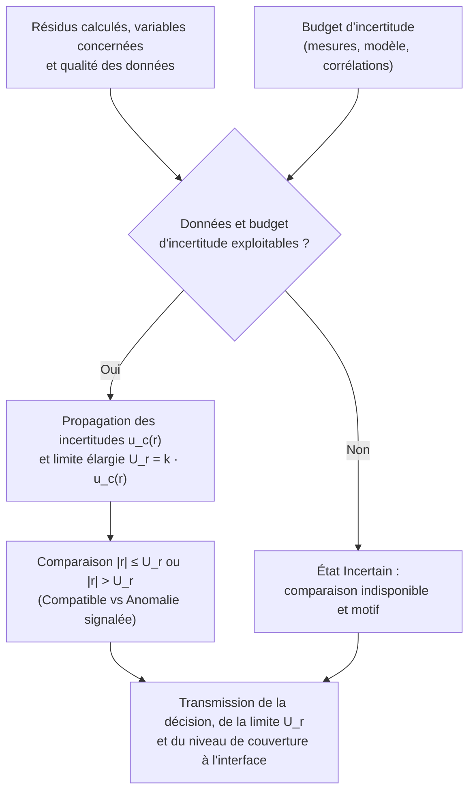
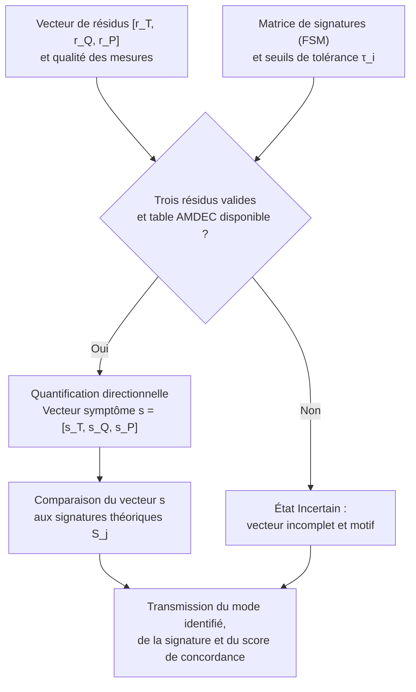
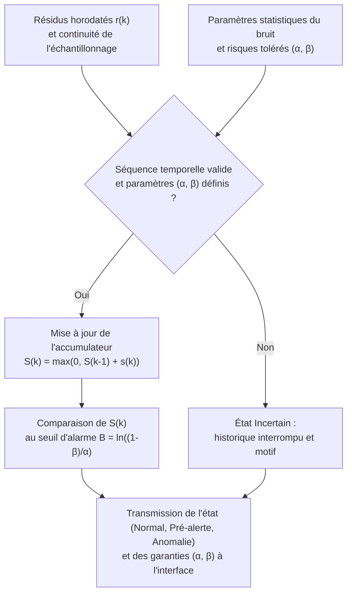

# Documentation Technique — Lot L7 : Décider si un résidu traduit une anomalie, et dire avec quelle confiance

**Projet :** Jumeau numérique cyberrésilient — Boucle thermohydraulique simplifiée (inspirée du [circuit de caloportage primaire CANDU 6](https://canteach.candu.org/Content%20Library/20044212.pdf) de la centrale [Gentilly-2 d'Hydro-Québec](https://archives.bape.gouv.qc.ca/sections/mandats/gentilly-2/documents/DA22-1.pdf))

**Fonction :** Décider si un résidu traduit une anomalie, et dire avec quelle confiance.

**Cadre normatif :** [CSA N290.7](https://www.csagroup.org/fr/store/product/2428461/) (Cybersécurité nucléaire), [CEI 62645](https://webstore.iec.ch/en/publication/32904) (Sécurité des systèmes d'I&C) et [CEI 62859](https://webstore.iec.ch/en/publication/26131) (Coordination sûreté et cybersécurité).

## Concept A : Décision par budget d'incertitude

### Présentation du concept

Ce concept consiste à comparer chaque résidu $r$ à une limite calculée à partir des incertitudes connues. Le budget d'incertitude recense les contributions susceptibles d'expliquer un écart : incertitude des mesures, paramètres physiques, approximations du modèle et traitements numériques.

L'objectif est d'éviter qu'un petit écart explicable soit systématiquement interprété comme une anomalie. À l'inverse, un résidu dépassant la limite retenue indique une incompatibilité avec le comportement attendu, compte tenu du budget établi.

Les contributions sont propagées jusqu'au résidu pour obtenir une incertitude-type composée $u_c(r)$. Une incertitude élargie $U_r$ peut ensuite être définie par :

$$
U_r = k \cdot u_c(r)
$$

où $k$ est un facteur de couverture choisi et justifié. Cette construction suit le principe de combinaison et d'élargissement des incertitudes décrit par le [NIST (Technical Note 1297)](https://www.nist.gov/pml/nist-technical-note-1297/nist-tn-1297-6-expanded-uncertainty). Les corrélations entre contributions doivent être prises en compte lorsqu'elles existent. L'utilisation de $U_r$ comme limite de décision constitue ici un choix de conception à valider par les essais.

### Schéma de la solution

### Description des composants

| Composant | Rôle | 
| ----- | ----- | 
| **Réception des résidus** | Recevoir les écarts calculés, les variables concernées et la qualité des données. | 
| **Budget d'incertitude** | Recenser les contributions, leurs valeurs, leur origine et leurs éventuelles corrélations. | 
| **Calculateur d'incertitude** | Propager les contributions pour obtenir une incertitude exprimée dans la même unité que le résidu. | 
| **Module de décision** | Comparer le résidu à la limite retenue et produire le résultat. | 
| **Gestion de l'incertitude** | Suspendre la conclusion lorsque les données ou le budget ne permettent pas une comparaison fiable. | 
| **Explication du résultat** | Fournir le résidu, la limite, les variables impliquées et les conditions de validité. | 

### Description du fonctionnement

1. Le système reçoit un résidu $r$ et vérifie que les données ayant servi à son calcul sont utilisables.

2. Il sélectionne le budget correspondant à la relation physique et aux conditions de fonctionnement.

3. Il calcule l'incertitude composée $u_c(r)$ du résidu et la limite de décision $U_r = k \cdot u_c(r)$.

4. Il applique la règle proposée :

| Condition | Résultat | 
| ----- | ----- | 
| **Données ou budget non exploitables** | **Incertain :** aucune conclusion fiable. | 
| $\vert r \vert \le U_r$ | **Compatible avec les incertitudes :** aucune anomalie mise en évidence par ce test. | 
| $\vert r \vert > U_r$ | **Anomalie signalée :** écart non expliqué par le budget retenu. | 

Il transmet la décision et sa justification à l'interface, sans commander la boucle ([CEI 62859](https://webstore.iec.ch/en/publication/26131)).

### Exemple illustratif

Supposons qu'un résidu de pression possède une limite de décision $U_r = 5\text{ kPa}$, obtenue à partir d'un budget validé :

* Un résidu de $3\text{ kPa}$ ($\vert r \vert \le 5\text{ kPa}$) reste compatible avec les incertitudes.

* Un résidu de $8\text{ kPa}$ ($\vert r \vert > 5\text{ kPa}$) dépasse la limite et déclenche un signalement.

* Si une mesure nécessaire manque, le résultat devient incertain.

Ces valeurs illustrent le mécanisme ; elles constituent des ordres de grandeur à calibrer lors des essais sur le prototype.

### Expression de la confiance et limites

L'interface présente le résidu, son incertitude $U_r$ et, lorsqu'il est justifié, le niveau de couverture associé (par exemple $95\ \%$ pour $k = 2$ sous hypothèse gaussienne selon le [NIST](https://www.nist.gov/pml/nist-technical-note-1297/nist-tn-1297-appendix-b-coverage-factors)). Un intervalle de couverture à $95\ \%$ ne signifie pas que le diagnostic est correct à $95\ \%$ : il renseigne sur l'incertitude évaluée, sous les hypothèses utilisées.

Un budget trop faible peut provoquer de fausses alertes ; un budget trop large peut masquer des anomalies. Son réglage devra donc être vérifié sur des scénarios normaux et défaillants. Enfin, un résultat compatible avec les incertitudes indique seulement que ce test n'a pas mis en évidence d'anomalie.

**Articulation amont-aval :** La référence par relations invariantes produit les résidus physiques ; la décision par budget d'incertitude détermine si ces résidus sont explicables, anormaux ou impossibles à interpréter de façon fiable.

## Concept B : Décision par signature (Matrice défaut-symptôme)

### Présentation du concept

Ce concept consiste à comparer simultanément le vecteur des trois résidus $\mathbf{r} = [r_T, r_Q, r_P]$ (température, débit, pression) à une [matrice de signatures défaut-symptôme (FSM)](https://drops.dagstuhl.de/storage/01oasics/oasics-vol136-dx2025/html/OASIcs.DX.2025.15/OASIcs.DX.2025.15.html) établie à la conception à partir de l'AMDEC (FMEA) et des lois de conservation thermohydrauliques.

L'objectif est d'exploiter le couplage physique entre les variables de la boucle pour non seulement détecter une anomalie, mais aussi distinguer une défaillance matérielle d'une cyberattaque sur l'instrumentation ([CSA N290.7](https://www.csagroup.org/fr/store/product/2428461/)). En effet, une anomalie physique modifie plusieurs variables couplées de manière cohérente, tandis qu'une falsification ou une panne d'un capteur isolé produit un écart sur une seule mesure, contredisant l'équilibre thermodynamique global.

Chaque résidu est comparé à son seuil de tolérance $\tau_i$ pour former un vecteur de symptômes directionnels $\mathbf{s} \in \{-1, 0, +1\}^3$ :

$$
s_i = \begin{cases} +1 & \text{si } r_i > +\tau_i \\ 0 & \text{si } \vert r_i \vert \le \tau_i \\ -1 & \text{si } r_i < -\tau_i \end{cases} \quad \text{pour } i \in \{T, Q, P\}
$$

Le vecteur observé $\mathbf{s} = [s_T, s_Q, s_P]$ est ensuite comparé aux signatures théoriques $\mathbf{S}_j$ de la table AMDEC afin d'identifier le mode défaillant et de quantifier un indice de proximité.

### Schéma de la solution

### Description des composants

| Composant | Rôle | 
| ----- | ----- | 
| **Réception du vecteur de résidus** | Regrouper à chaque pas de temps les écarts de température ($r_T$), débit ($r_Q$) et pression ($r_P$) et vérifier leur disponibilité simultanée. | 
| **Générateur de symptômes** | Comparer chaque résidu à son seuil $\tau_i$ pour coder le sens de variation ($-1$ baisse, $0$ normal, $+1$ hausse). | 
| **Matrice de signatures (AMDEC)** | Recenser les vecteurs théoriques $\mathbf{S}_j$ associés aux pannes physiques (fuite, pompe, échangeur) et aux compromissions de capteurs ([CEI 62645](https://webstore.iec.ch/en/publication/32904)). | 
| **Module d'appariement** | Comparer le vecteur observé $\mathbf{s}$ aux signatures de référence et calculer le degré d'alignement. | 
| **Gestion des cas non résolus** | Signaler un état incertain ou une anomalie non répertoriée lorsqu'un capteur est indisponible ou qu'aucune signature ne correspond. | 
| **Explication du résultat** | Présenter à l'opérateur la signature observée, la signature théorique retenue et le score de concordance. | 

### Description du fonctionnement

1. Le système reçoit le triplet de résidus $[r_T, r_Q, r_P]$ et vérifie que les trois voies de mesure sont valides au même instant.

2. Il applique les seuils $\pm \tau_i$ pour construire le vecteur symptôme observé $\mathbf{s} = [s_T, s_Q, s_P]$.

3. Il compare ce vecteur aux colonnes $\mathbf{S}_j$ de la matrice de signatures AMDEC.

4. Il applique la règle de décision suivante :

| Condition | Résultat | 
| ----- | ----- | 
| **Une ou plusieurs mesures indisponibles** | **Incertain :** vecteur incomplet, isolation par signature impossible. | 
| $\mathbf{s} = [0, 0, 0]$ | **Compatible avec l'état nominal :** aucun dépassement de seuil observé. | 
| $\mathbf{s} = \mathbf{S}_j$ **(signature répertoriée)** | **Anomalie identifiée (**$F_j$**) :** défaut physique (multi-variables) ou anomalie capteur/cyber (mono-variable) isolé. | 
| $\mathbf{s} \neq [0, 0, 0]$ **et** $\mathbf{s} \notin \{\mathbf{S}_j\}$ | **Anomalie non répertoriée :** écart réel dont le motif ne correspond à aucun scénario connu (défaut multiple ou attaque inédite). | 

Il transmet le diagnostic et le motif observé à l'interface opérateur, sans action directe sur le procédé ([CEI 62859](https://webstore.iec.ch/en/publication/26131)).

### Exemple illustratif

Supposons que la matrice AMDEC définisse la signature $[+1, -1, 0]$ pour une dégradation de pompe primaire (hausse de température et baisse de débit à pression stable) et $[+1, 0, 0]$ pour un biais ou une attaque sur le capteur de température :

* Si les résidus codés donnent $[0, 0, 0]$, le comportement est jugé nominal.

* Si le vecteur observé vaut $[+1, -1, 0]$, le système signale une anomalie physique compatible avec une perte de débit de pompage.

* Si le vecteur observé vaut $[+1, 0, 0]$, le système signale une anomalie isolée sur la chaîne de mesure de température (suspicion de dérive capteur ou de falsification cyber).

Ces signatures illustrent la logique d'isolation ; la table complète dépend des modes retenus lors de l'AMDEC du prototype.

### Expression de la confiance et limites

L'interface présente le vecteur observé à côté de la signature théorique retenue, accompagné d'un indice de concordance (calculé par similarité angulaire entre le vecteur de résidus normalisés et la signature idéale). Une concordance élevée indique que la direction des écarts correspond fidèlement au scénario AMDEC, mais ne constitue pas une preuve absolue en cas d'attaque coordonnée imitant une signature physique.

Ce concept permet un diagnostic causal immédiat et très explicable lors d'un défaut franc. En revanche, étant purement instantané, il est sensible aux pointes de bruit passagères et ne détecte pas les dérives lentes tant qu'elles restent inférieures aux seuils $\tau_i$.

## Concept C : Décision séquentielle (Accumulation temporelle SPRT / CUSUM)

### Présentation du concept

Ce concept consiste à accumuler l'information statistique des résidus au fil du temps avant de prendre une décision, en s'appuyant sur le [test séquentiel du rapport de vraisemblance (SPRT) de Wald](https://www.me.psu.edu/ray/journalAsokRay/1983/020RayDesaiDeyst1983.pdf) ou la [somme cumulée (CUSUM)](https://www.researchgate.net/publication/281567648_The_CuSum_algorithm_-_a_small_review).

L'objectif est double : éliminer les fausses alertes provoquées par des pointes de bruit isolées et détecter des anomalies de faible amplitude mais persistantes (usure progressive ou cyberattaque furtive par dérive lente). Plutôt que d'utiliser un seuil instantané fixe, le concept définit la règle d'arrêt à partir des risques d'erreur déclarés : la probabilité maximale de **fausse alarme (**$\alpha$**)** et la probabilité maximale de **non-détection (**$\beta$**)**.

À chaque pas de temps $k$, le résidu alimente une somme cumulée positive $S(k)$ qui évalue la persistance d'un écart par rapport au bruit nominal :

$$
S(k) = \max\!\big(0, \, S(k-1) + s(k)\big) \quad \text{avec un seuil d'alarme } B = \ln\!\left(\frac{1 - \beta}{\alpha}\right)
$$

où $s(k)$ est l'incrément de log-vraisemblance (négatif en moyenne sous un bruit centré, positif en présence d'une dérive persistante).

### Schéma de la solution

### Description des composants

| Composant | Rôle | 
| ----- | ----- | 
| **Réception séquentielle** | Recevoir les résidus horodatés et vérifier la continuité temporelle de l'échantillonnage. | 
| **Calculateur d'incrément** | Évaluer à chaque pas de temps le score élémentaire $s(k)$ comparant l'hypothèse de dérive à l'hypothèse de bruit centré. | 
| **Accumulateur à mémoire** | Mettre à jour la somme cumulée $S(k)$ à partir de la valeur précédente $S(k-1)$ et mémoriser l'instant de début d'accumulation. | 
| **Gestionnaire des seuils (**$\alpha, \beta$**)** | Calculer la limite de décision $B = \ln((1-\beta)/\alpha)$ garantissant le respect des taux d'erreur choisis. | 
| **Module de décision séquentielle** | Déterminer si l'état est normal ($S(k) = 0$), en observation ($0 < S(k) < B$) ou en anomalie confirmée ($S(k) \ge B$). | 
| **Explication du résultat** | Afficher l'évolution de la somme cumulée $S(k)$, la limite $B$, l'instant de début de dérive et les risques $(\alpha, \beta)$ garantis. | 

### Description du fonctionnement

1. Le système reçoit le résidu à l'instant $k$ et vérifie l'absence de perte prolongée d'échantillons.

2. Il calcule l'incrément statistique $s(k)$ à partir des caractéristiques nominales du bruit.

3. Il met à jour l'accumulateur $S(k) = \max(0, S(k-1) + s(k))$ et le compare au seuil $B$ fixé par $(\alpha, \beta)$.

4. Il applique la règle de décision séquentielle :

| Condition | Résultat | 
| ----- | ----- | 
| **Perte de continuité temporelle des mesures** | **Incertain :** accumulation interrompue, décision suspendue. | 
| $S(k) = 0$ | **Compatible avec l'état nominal :** fluctuations aléatoires résorbées par la moyenne nulle. | 
| $0 < S(k) < B$ | **Zone d'indécision (Pré-alerte) :** dérive suspectée mais information encore insuffisante pour garantir $(\alpha, \beta)$ ; poursuite de l'accumulation. | 
| $S(k) \ge B$ | **Anomalie confirmée :** dérive persistante détectée au niveau de risque déclaré $(\alpha, \beta)$. | 

Il transmet l'état séquentiel, la progression $S(k)/B$ et l'horodatage de début de dérive à l'interface, sans commander le système ([CEI 62859](https://webstore.iec.ch/en/publication/26131)).

### Exemple illustratif

Supposons que l'on fixe un risque de fausse alarme $\alpha = 1\ \%$ et de non-détection $\beta = 1\ \%$, ce qui conduit à un seuil d'alarme $B = \ln(0{,}99 / 0{,}01) \approx 4{,}6$ :

* Une pointe de bruit isolée fait monter ponctuellement $S(k)$ à $1{,}8$, puis les mesures suivantes normales ramènent $S(k)$ à $0$ sans déclencher d'alerte.

* Une cyberattaque furtive ou une micro-fuite créant un léger biais constant fait croître $S(k)$ pas après pas ($1{,}2 \rightarrow 2{,}5 \rightarrow 3{,}9 \rightarrow 4{,}8$) : au quatrième pas, $S(k)$ dépasse $4{,}6$ et déclenche l'alarme confirmée.

* Si la communication capteur est coupée durant la séquence, l'état bascule en incertain.

Ces valeurs illustrent l'accumulation temporelle ; les risques $\alpha$ et $\beta$ seront fixés selon les objectifs de sûreté du prototype.

### Expression de la confiance et limites

L'interface présente le ratio de progression $S(k)/B$ ainsi que les probabilités d'erreur $(\alpha, \beta)$ associées au seuil $B$. Lorsque le seuil $B$ est franchi, la confiance s'exprime directement par le niveau de garantie statistique $(1 - \alpha)$ (soit $99\ \%$ dans l'exemple ci-dessus), sous réserve que le modèle de bruit nominal soit valide.

Un choix de risques $(\alpha, \beta)$ très stricts augmente le seuil $B$, ce qui réduit fortement les fausses alertes mais rallonge le temps d'accumulation avant déclaration d'une anomalie faible. Enfin, ce concept détecte avec une grande finesse *quand* une variable commence à dériver ([CSA N290.7](https://www.csagroup.org/fr/store/product/2428461/)), mais nécessite d'analyser conjointement les trois voies $(T, Q, P)$ pour identifier le composant physique en cause.

## Synthèse comparative et articulation des trois concepts (Lot L7)

| Critère de comparaison | Concept A : Budget d'incertitude ([NIST](https://www.nist.gov/pml/nist-technical-note-1297/nist-tn-1297-6-expanded-uncertainty)) | Concept B : Décision par signature ([AMDEC / FSM](https://drops.dagstuhl.de/storage/01oasics/oasics-vol136-dx2025/html/OASIcs.DX.2025.15/OASIcs.DX.2025.15.html)) | Concept C : Décision séquentielle ([SPRT](https://www.me.psu.edu/ray/journalAsokRay/1983/020RayDesaiDeyst1983.pdf) / [CUSUM](https://www.researchgate.net/publication/281567648_The_CuSum_algorithm_-_a_small_review)) | 
| ----- | ----- | ----- | ----- | 
| **Principe de décision** | Comparaison d'un résidu $r$ à son incertitude élargie $U_r = k \cdot u_c(r)$. | Comparaison du triplet $[r_T, r_Q, r_P]$ à une table de signatures défaut-symptôme. | Accumulation temporelle $S(k)$ jusqu'au seuil $B = \ln((1-\beta)/\alpha)$. | 
| **Expression de la confiance** | Intervalle de couverture métrologique (ex. $95\ \%$ pour $k=2$). | Degré de concordance directionnelle avec une signature connue. | Garantie statistique bornée par les probabilités d'erreur $(\alpha, \beta)$. | 
| **Force principale** | Rigueur métrologique et justification physique directe du seuil $U_r$. | Isolation causale immédiate (distingue panne physique vs attaque capteur). | Immunité aux pointes de bruit et détection des dérives lentes furtives. | 
| **Limite principale** | Aveugle aux dérives inférieures à $U_r$ et sensible aux pics dépassant $U_r$. | Nécessite une base AMDEC exhaustive ; pas de mémoire temporelle. | Introduit un délai d'accumulation ; n'identifie pas seul la cause physique. | 

## Définition de l'évaluation des concepts (Grille de critères, pondérations et barèmes)

Afin de comparer objectivement les **Concepts A, B et C** pour la fonction *« Décider si un résidu traduit une anomalie, et dire avec quelle confiance »*, la grille suivante définit les critères d'évaluation, leur pondération (total de **100 points**), les barèmes de notation gradués ainsi que les spécifications minimales et maximales exigées par le cadre de sûreté ([CSA N290.7](https://www.csagroup.org/fr/store/product/2428461/), [CEI 62645](https://webstore.iec.ch/en/publication/32904), [CEI 62859](https://webstore.iec.ch/en/publication/26131)).

| Critères | Pondération | Barèmes | Spécification min. | Spécification max. |
| :--- | :---: | :--- | :---: | :---: |
| **Performance de détection et diagnostic** | **40** | | | |
| ↳ Détection des dérives lentes et cyberattaques furtives | 15 | • Écart détecté $< 1{,}5\,\sigma$ (accumulation) $\rightarrow 100\ \%$ • Écart détecté entre $1{,}5\,\sigma$ et $2{,}5\,\sigma \rightarrow 75\ \%$ • Écart détecté uniquement si $> 3\,\sigma$ (seuil fixe) $\rightarrow 50\ \%$ • Écart détecté $> 5\,\sigma \rightarrow 25\ \%$ • Aucune détection d'écart $\rightarrow \text{rejet}$ | — | Seuil $\le 3{,}0\,\sigma$ (ou $U_r$) |
| ↳ Temps de latence sur anomalie franche | 15 | • $t \le 1$ pas de temps ($\Delta t$) $\rightarrow 100\ \%$ • $1\,\Delta t < t \le 3\,\Delta t \rightarrow 75\ \%$ • $3\,\Delta t < t \le 5\,\Delta t \rightarrow 50\ \%$ • $5\,\Delta t < t \le 10\,\Delta t \rightarrow 25\ \%$ • $t > 10\,\Delta t \rightarrow \text{rejet}$ | — | $10\,\Delta t$ |
| ↳ Capacité d'isolation (physique vs cyber capteur) | 10 | • Isolation du défaut physique et du capteur compromis $\rightarrow 100\ \%$ • Variable en défaut + instant d'apparition $\hat{k}_0 \rightarrow 75\ \%$ • Détection par variable sans isolation causale $\rightarrow 50\ \%$ • Détection globale sans localisation $\rightarrow 0\ \%$ | Détection par variable | — |
| **Fiabilité et quantification de la confiance** | **35** | | | |
| ↳ Rigueur de l'indice de confiance fourni | 15 | • Garantie probabiliste $(\alpha, \beta)$ + progression continue $\rightarrow 100\ \%$ • Intervalle de couverture métrologique $U_r = k \cdot u_c(r) \rightarrow 75\ \%$ • Score de concordance géométrique $[0\text{–}100\ \%] \rightarrow 50\ \%$ • Sortie binaire sans niveau de confiance $\rightarrow \text{rejet}$ | Confiance quantifiée | — |
| ↳ Taux de fausses alertes en régime bruité ($\alpha$) | 10 | • $\alpha \le 0{,}1\ \%$ (immunité aux pointes isolées) $\rightarrow 100\ \%$ • $0{,}1\ \% < \alpha \le 1\ \% \rightarrow 75\ \%$ • $1\ \% < \alpha \le 5\ \% \rightarrow 50\ \%$ • $\alpha > 5\ \% \rightarrow \text{rejet}$ | — | $5\ \%$ |
| ↳ Gestion des données invalides ou manquantes | 10 | • État « Incertain » explicite et suspension du test $\rightarrow 100\ \%$ • Maintien de la dernière valeur avec avertissement $\rightarrow 50\ \%$ • Décision erronée sur données manquantes $\rightarrow \text{rejet}$ | Suspension du test | — |
| **Sûreté de conduite et explicabilité (CEI 62859)** | **15** | | | |
| ↳ Non-ingérence sur le contrôle de la boucle | 5 | • Aide passive à l'opérateur (aucune commande) $\rightarrow 100\ \%$ • Action automatique directe sur la boucle $\rightarrow \text{rejet}$ | — | $0$ commande directe |
| ↳ Clarté et justification du résultat à l'interface | 10 | • Résidu + limite + cause/origine + validité $\rightarrow 100\ \%$ • Résidu + limite + conditions de validité $\rightarrow 75\ \%$ • Indicateur chiffré seul sans contexte $\rightarrow 25\ \%$ • Alerte opaque (« boîte noire ») $\rightarrow \text{rejet}$ | Résidu et limite affichés | — |
| **Simplicité d'implantation et de calibration** | **10** | | | |
| ↳ Effort de paramétrage et mise en œuvre logicielle | 10 | • $\le 3$ paramètres par voie (calcul récursif direct) $\rightarrow 100\ \%$ • $4$ à $6$ paramètres (table AMDEC ou budget simple) $\rightarrow 75\ \%$ • $> 6$ paramètres avec corrélations complexes $\rightarrow 50\ \%$ • Algorithme non déterministe $\rightarrow \text{rejet}$ | Algorithme déterministe | — |
| **TOTAL** | **100** | | | |

### Justification des pondérations et application aux trois concepts

1. **Performance de détection et diagnostic (40 pts) :** Cœur fonctionnel du Lot L7. Le système doit réagir vite sur un défaut franc ($15\text{ pts}$) tout en décelant les dérives lentes ou cyberattaques furtives ($15\text{ pts}$) et en aidant à distinguer une panne thermohydraulique d'un défaut de capteur ($10\text{ pts}$).
2. **Fiabilité et quantification de la confiance (35 pts) :** Répond directement à la seconde moitié de la fonction (*« dire avec quelle confiance »*). Un système nucléaire ([CEI 62859](https://webstore.iec.ch/en/publication/26131)) doit borner le risque de fausses alertes ($10\text{ pts}$), fonder mathématiquement son niveau de confiance ($15\text{ pts}$) et suspendre sa conclusion lorsque les mesures sont incomplètes ($10\text{ pts}$).
3. **Sûreté de conduite et explicabilité (15 pts) :** Garantit l'absence d'automatisme aveugle ($5\text{ pts}$, critère éliminatoire en cas de commande directe) et la transparence du diagnostic présenté à l'opérateur ($10\text{ pts}$).
4. **Simplicité d'implantation et de calibration (10 pts) :** Évalue la facilité de réglage et de vérification formelle du module logiciel dans le prototype ([CEI 62645](https://webstore.iec.ch/en/publication/32904)).

### Résultat de l'évaluation pondérée des trois concepts

| Sous-critère | Poids | Concept A : Budget d'incertitude | Concept B : Décision par signature | Concept C : Décision séquentielle |
| :--- | :---: | :---: | :---: | :---: |
| Détection des dérives lentes / cyber furtives | 15 | $50\ \%$ ($7{,}5\text{ pts}$) | $50\ \%$ ($7{,}5\text{ pts}$) | $100\ \%$ ($15{,}0\text{ pts}$) |
| Temps de latence sur anomalie franche | 15 | $100\ \%$ ($15{,}0\text{ pts}$) | $100\ \%$ ($15{,}0\text{ pts}$) | $75\ \%$ ($11{,}25\text{ pts}$) |
| Capacité d'isolation (physique vs cyber) | 10 | $50\ \%$ ($5{,}0\text{ pts}$) | $100\ \%$ ($10{,}0\text{ pts}$) | $75\ \%$ ($7{,}5\text{ pts}$) |
| Rigueur de l'indice de confiance | 15 | $75\ \%$ ($11{,}25\text{ pts}$) | $50\ \%$ ($7{,}5\text{ pts}$) | $100\ \%$ ($15{,}0\text{ pts}$) |
| Taux de fausses alertes en régime bruité | 10 | $75\ \%$ ($7{,}5\text{ pts}$) | $50\ \%$ ($5{,}0\text{ pts}$) | $100\ \%$ ($10{,}0\text{ pts}$) |
| Gestion des données invalides / manquantes | 10 | $100\ \%$ ($10{,}0\text{ pts}$) | $100\ \%$ ($10{,}0\text{ pts}$) | $100\ \%$ ($10{,}0\text{ pts}$) |
| Non-ingérence sur le contrôle de la boucle | 5 | $100\ \%$ ($5{,}0\text{ pts}$) | $100\ \%$ ($5{,}0\text{ pts}$) | $100\ \%$ ($5{,}0\text{ pts}$) |
| Clarté et justification à l'interface | 10 | $75\ \%$ ($7{,}5\text{ pts}$) | $100\ \%$ ($10{,}0\text{ pts}$) | $75\ \%$ ($7{,}5\text{ pts}$) |
| Effort de paramétrage et d'implantation | 10 | $50\ \%$ ($5{,}0\text{ pts}$) | $75\ \%$ ($7{,}5\text{ pts}$) | $100\ \%$ ($10{,}0\text{ pts}$) |
| **Total pondéré (sur 100 points)** | **100** | **73,75 / 100** | **77,50 / 100** | **91,25 / 100** |
