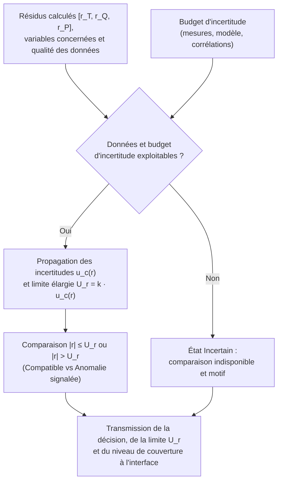
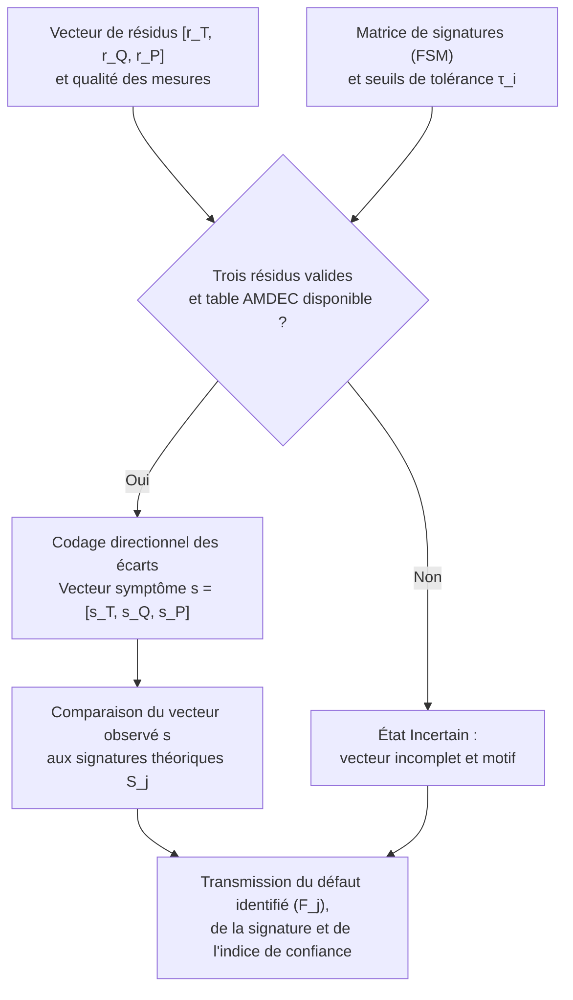
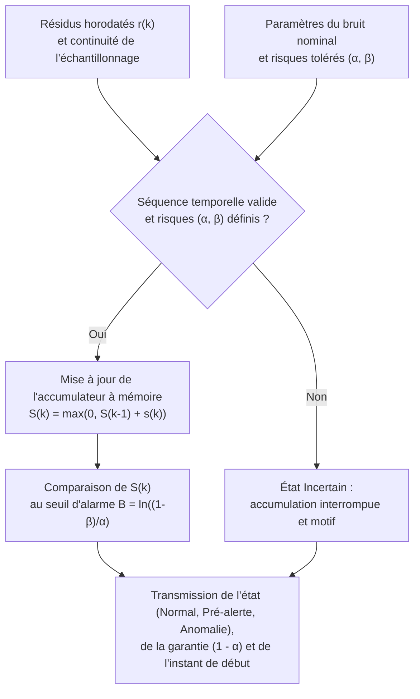

# Documentation Technique — Lot L7 : Détection d'Anomalies et Quantification de l'Incertitude

**Projet :** Jumeau numérique cyberrésilient — Boucle thermohydraulique simplifiée (inspirée du [circuit de caloportage primaire CANDU 6](https://canteach.candu.org/Content%20Library/20044212.pdf) de la centrale [Gentilly-2 d'Hydro-Québec](https://archives.bape.gouv.qc.ca/sections/mandats/gentilly-2/documents/DA22-1.pdf))  
**Fonction technique (Lot L7) :** *« Décider si un résidu traduit une anomalie, et dire avec quelle confiance. »*  
**Cadre normatif :** [CSA N290.7](https://www.csagroup.org/fr/store/product/2428461/) (Cybersécurité pour les installations nucléaires), [CEI 62645](https://webstore.iec.ch/en/publication/32904) (Sécurité des systèmes d'instrumentation et de contrôle) et [CEI 62859](https://webstore.iec.ch/en/publication/26131) (Coordination entre la sûreté et la cybersécurité).

## Sommaire

* [1. Contexte et Rôle de la Fonction de Décision](#1-contexte-et-rôle-de-la-fonction-de-décision)

* [2. Concept A : Décision par Budget d'Incertitude (Approche Métrologique)](#2-concept-a-décision-par-budget-dincertitude-approche-métrologique)

  * [2.1 Présentation du concept et réponse au besoin](#21-présentation-du-concept-et-réponse-au-besoin)

  * [2.2 Schéma de la solution](#22-schéma-de-la-solution)

  * [2.3 Description des composants](#23-description-des-composants)

  * [2.4 Description du fonctionnement et évaluation de la confiance](#24-description-du-fonctionnement-et-évaluation-de-la-confiance)

  * [2.5 Expression de la confiance, limites et conformité sûreté](#25-expression-de-la-confiance-limites-et-conformité-sûreté)

* [3. Concept B : Décision par Signature (Approche Spatiale AMDEC / FSM)](#3-concept-b-décision-par-signature-approche-spatiale-amdec--fsm)

  * [3.1 Présentation du concept et réponse au besoin](#31-présentation-du-concept-et-réponse-au-besoin)

  * [3.2 Schéma de la solution](#32-schéma-de-la-solution)

  * [3.3 Description des composants](#33-description-des-composants)

  * [3.4 Description du fonctionnement et évaluation de la confiance](#34-description-du-fonctionnement-et-évaluation-de-la-confiance)

  * [3.5 Expression de la confiance, limites et conformité sûreté](#35-expression-de-la-confiance-limites-et-conformité-sûreté)

* [4. Concept C : Décision Séquentielle (Approche Temporelle SPRT / CUSUM)](#4-concept-c-décision-séquentielle-approche-temporelle-sprt--cusum)

  * [4.1 Présentation du concept et réponse au besoin](#41-présentation-du-concept-et-réponse-au-besoin)

  * [4.2 Schéma de la solution](#42-schéma-de-la-solution)

  * [4.3 Description des composants](#43-description-des-composants)

  * [4.4 Description du fonctionnement et évaluation de la confiance](#44-description-du-fonctionnement-et-évaluation-de-la-confiance)

  * [4.5 Expression de la confiance, limites et conformité sûreté](#45-expression-de-la-confiance-limites-et-conformité-sûreté)

* [5. Définition de l'Évaluation des Concepts (Grille de Critères, Barèmes et Spécifications)](#5-définition-de-lévaluation-des-concepts-grille-de-critères-barèmes-et-spécifications)

## 1. Contexte et Rôle de la Fonction de Décision

À chaque pas de temps $k$, le jumeau numérique compare les mesures issues des capteurs de la boucle aux valeurs prédites par le modèle thermohydraulique de référence. Il produit ainsi trois résidus correspondant aux variables physiques surveillées :
- **Résidu de température ($r_T$) :** $r_T = T_{\text{mesurée}} - T_{\text{modèle}}$
- **Résidu de débit ($r_Q$) :** $r_Q = Q_{\text{mesuré}} - Q_{\text{modèle}}$
- **Résidu de pression ($r_P$) :** $r_P = P_{\text{mesurée}} - P_{\text{modèle}}$

En fonctionnement normal, ces résidus ne sont jamais strictement nuls en raison du bruit de mesure et des approximations du modèle. Le rôle de la fonction du Lot L7 est de déterminer si un écart observé s'explique par ces imprécisions normales ou s'il traduit une anomalie réelle (défaillance matérielle ou cyberattaque), tout en quantifiant le niveau de confiance associé. Conformément à la norme [CEI 62859](https://webstore.iec.ch/en/publication/26131), ce système agit uniquement comme une aide à la décision : il éclaire l'opérateur humain sans jamais commander directement le procédé.

## 2. Concept A : Décision par Budget d'Incertitude (Approche Métrologique)

### 2.1 Présentation du concept et réponse au besoin

Ce concept consiste à comparer chaque résidu $r$ à une limite calculée à partir des incertitudes connues du système. Le budget d'incertitude recense toutes les sources susceptibles d'expliquer un écart en régime sain : l'imprécision des capteurs (température, débit, pression), les tolérances sur les paramètres physiques de la boucle, les approximations du modèle thermohydraulique et les erreurs de calcul numérique.

L'objectif est d'éviter qu'un petit écart explicable soit interprété à tort comme une anomalie (fausse alerte). À l'inverse, un résidu qui dépasse la limite établie signale une incompatibilité physique avec le comportement attendu.

Les différentes sources d'incertitude sont combinées pour obtenir une incertitude-type composée $u_c(r)$, exprimée dans la même unité que la variable surveillée ($^\circ\text{C}$, $\text{kg/s}$ ou $\text{kPa}$). La limite de décision, appelée incertitude élargie $U_r$, est ensuite fixée par :

$$U_r = k \cdot u_c(r)$$

où $k$ est un facteur de couverture choisi selon le niveau de garantie souhaité (par exemple $k = 2$ pour couvrir environ $95\ \%$ des variations normales, ou $k = 3$ pour $99{,}7\ \%$). Cette démarche s'appuie sur la méthode normalisée de propagation des incertitudes du [NIST (Technical Note 1297)](https://www.nist.gov/pml/nist-technical-note-1297/nist-tn-1297-6-expanded-uncertainty), en tenant compte des corrélations éventuelles entre les variables de la boucle.

### 2.2 Schéma de la solution

### 2.3 Description des composants

| Composant | Rôle fonctionnel |
| :--- | :--- |
| **Réception des résidus** | Recevoir les écarts calculés ($r_T, r_Q, r_P$), identifier les variables concernées et vérifier la qualité des données. |
| **Budget d'incertitude** | Recenser les sources d'incertitude (capteurs, paramètres, modèle), leurs valeurs et leurs corrélations. |
| **Calculateur d'incertitude** | Propager les contributions pour calculer l'incertitude composée $u_c(r)$ et la limite de décision $U_r$ dans l'unité de la variable. |
| **Module de décision** | Comparer la valeur absolue du résidu $\vert r \vert$ à la limite retenue $U_r$ et établir le diagnostic. |
| **Gestion de l'incertitude** | Suspendre la conclusion et déclarer l'état *Incertain* lorsque les mesures ou le budget ne permettent pas une comparaison fiable. |
| **Explication du résultat** | Présenter à l'opérateur la valeur du résidu, la limite $U_r$, les variables impliquées et les conditions de validité. |

### 2.4 Description du fonctionnement et évaluation de la confiance

À chaque pas de temps, le module exécute les quatre étapes suivantes :
1. **Vérification des entrées :** Le système reçoit un résidu ($r_T, r_Q$ ou $r_P$) et vérifie que les mesures ayant servi à son calcul sont disponibles et valides.
2. **Sélection du budget :** Il sélectionne le budget d'incertitude correspondant à la variable évaluée et au régime de fonctionnement de la boucle.
3. **Calcul du seuil :** Il détermine l'incertitude composée $u_c(r)$ puis la limite de décision $U_r = k \cdot u_c(r)$.
4. **Application de la règle de décision :** Il compare le résidu à la limite selon le tableau ci-dessous et transmet le résultat à l'interface opérateur sans agir sur la boucle.

| Condition | Résultat |
| :--- | :--- |
| **Données ou budget non exploitables** | **Incertain :** aucune conclusion fiable possible (comparaison suspendue). |
| **$\vert r \vert \le U_r$** | **Compatible avec les incertitudes :** aucune anomalie mise en évidence par ce test. |
| **$\vert r \vert > U_r$** | **Anomalie signalée :** écart dépassant ce que le budget d'incertitude peut expliquer. |

#### Exemple illustratif
Supposons qu'un résidu de pression $r_P$ possède une incertitude composée $u_c(r_P) = 2{,}5\text{ kPa}$ et que l'on choisisse un facteur $k = 2$ (niveau de couverture de $95\ \%$), ce qui fixe la limite de décision à $U_r = 5\text{ kPa}$ :
- Un résidu mesuré de $3\text{ kPa}$ ($\vert r_P \vert \le 5\text{ kPa}$) reste compatible avec les incertitudes normales.
- Un résidu mesuré de $8\text{ kPa}$ ($\vert r_P \vert > 5\text{ kPa}$) dépasse la limite et déclenche un signalement d'anomalie.
- Si un capteur nécessaire au calcul est déconnecté, le résultat passe à l'état **Incertain**.

Ces valeurs illustrent le principe de fonctionnement ; les seuils réels seront déterminés lors des essais de caractérisation du prototype.

### 2.5 Expression de la confiance, limites et conformité sûreté

- **Expression de la confiance :** L'interface affiche le résidu mesuré en regard de la limite $U_r$ ainsi que le niveau de couverture associé au facteur $k$ (par exemple $95\ \%$ pour $k = 2$ selon le [NIST](https://www.nist.gov/pml/nist-technical-note-1297/nist-tn-1297-appendix-b-coverage-factors)). Un niveau de couverture à $95\ \%$ ne signifie pas que le diagnostic est vrai à $95\ \%$ : il indique que, sous les hypothèses du budget, le bruit normal a $95\ \%$ de chances de rester sous $U_r$.
- **Forces et limites :** Ce concept offre une justification physique et métrologique directe du seuil de décision. Toutefois, un budget sous-estimé provoquera des fausses alertes sur des pointes de bruit, tandis qu'un budget trop large masquera des dérives lentes ou des cyberattaques furtives d'amplitude inférieure à $U_r$. De plus, analysé variable par variable, il signale un dépassement sans préciser s'il provient d'une panne matérielle ou d'un capteur falsifié.
- **Conformité aux normes ([CSA N290.7](https://www.csagroup.org/fr/store/product/2428461/) / [CEI 62859](https://webstore.iec.ch/en/publication/26131)) :** L'état *Incertain* empêche toute conclusion trompeuse en cas de perte de données, et l'affichage explicite de la marge par rapport à $U_r$ assiste l'opérateur sans automatisme aveugle.

## 3. Concept B : Décision par Signature (Approche Spatiale AMDEC / FSM)

### 3.1 Présentation du concept et réponse au besoin

Ce concept consiste à analyser conjointement les trois résidus $[r_T, r_Q, r_P]$ en les comparant à une [matrice de signatures défaut-symptôme (FSM)](https://drops.dagstuhl.de/storage/01oasics/oasics-vol136-dx2025/html/OASIcs.DX.2025.15/OASIcs.DX.2025.15.html) établie lors de l'analyse des modes de défaillance (AMDEC / FMEA) de la boucle thermohydraulique.

L'objectif est de tirer parti des lois physiques qui relient la température, le débit et la pression au sein du [circuit de refroidissement CANDU](https://canteach.candu.org/Content%20Library/20044212.pdf) pour **distinguer une défaillance physique réelle d'une cyberattaque ou d'une panne de capteur**. En effet, un événement physique dans la boucle modifie simultanément plusieurs variables dans des directions cohérentes, alors que la falsification informatique d'une mesure (*spoofing*) crée un écart isolé sur un seul capteur, ce qui contredit l'équilibre physique des deux autres variables.

Chaque résidu $r_i$ ($i \in \{T, Q, P\}$) est comparé à un seuil de tolérance $\tau_i$ pour être traduit en un symptôme directionnel simple $s_i \in \{-1, 0, +1\}$ :

$$s_i = \begin{cases} +1 & \text{si } r_i > +\tau_i \quad (\text{écart positif anormal}) \\ 0 & \text{si } \vert r_i \vert \le \tau_i \quad (\text{comportement normal dans le bruit}) \\ -1 & \text{si } r_i < -\tau_i \quad (\text{écart négatif anormal}) \end{cases}$$

Le vecteur de symptômes observé $\mathbf{s} = [s_T, s_Q, s_P]$ est ensuite comparé aux signatures de référence répertoriées dans la table AMDEC ci-dessous :

| Code | Scénario d'anomalie (Physique ou Cyber) | Température ($s_T$) | Débit ($s_Q$) | Pression ($s_P$) | Explication physique pour l'opérateur |
| :--- | :--- | :---: | :---: | :---: | :--- |
| **$F_0$** | Régime normal (aucune anomalie) | $0$ | $0$ | $0$ | Les trois résidus restent dans leur bande de tolérance $\pm \tau_i$. |
| **$F_1$** | Fuite de réfrigérant primaire (Physique) | $+1$ | $-1$ | $-1$ | La fuite fait chuter la pression et le débit, ce qui réduit le refroidissement et élève la température. |
| **$F_2$** | Défaillance ou cavitation de pompe (Physique) | $+1$ | $-1$ | $0$ | La baisse de débit réduit l'évacuation de chaleur (hausse de $T$) alors que la pression reste régulée. |
| **$F_3$** | Encrassement de l'échangeur thermique (Physique) | $+1$ | $0$ | $+1$ | La perte de refroidissement fait monter la température et dilate le fluide (hausse de $P$) à débit constant. |
| **$F_4$** | Compromission ou biais du capteur $T$ (Cyber / Sonde) | $\pm 1$ | $0$ | $0$ | Écart isolé sur la température sans variation du débit ni de la pression (incohérence thermodynamique). |
| **$F_5$** | Compromission ou biais du capteur $Q$ (Cyber / Sonde) | $0$ | $\pm 1$ | $0$ | Écart isolé sur le débit sans effet sur la température ni sur la perte de charge. |
| **$F_6$** | Compromission ou biais du capteur $P$ (Cyber / Sonde) | $0$ | $0$ | $\pm 1$ | Écart isolé sur la pression contredisant la stabilité thermique et hydraulique observée sur $T$ et $Q$. |

### 3.2 Schéma de la solution

### 3.3 Description des composants

| Composant | Rôle fonctionnel |
| :--- | :--- |
| **Réception du vecteur de résidus** | Regrouper au même instant les trois écarts $[r_T, r_Q, r_P]$ et vérifier que les trois capteurs sont valides. |
| **Générateur de symptômes** | Normaliser chaque résidu par son bruit nominal $\sigma_i$ et appliquer les seuils $\pm \tau_i$ pour former le vecteur directionnel $\mathbf{s} = [s_T, s_Q, s_P]$. |
| **Matrice de signatures (AMDEC)** | Stocker en mémoire protégée ([CEI 62645](https://webstore.iec.ch/en/publication/32904)) la table de référence reliant chaque mode de défaillance $F_j$ à sa signature théorique $\mathbf{S}_j$. |
| **Module d'appariement et de confiance** | Identifier la signature théorique $\mathbf{S}_j$ qui correspond au vecteur observé et calculer le pourcentage de confiance associé. |
| **Gestion des cas non résolus** | Déclarer l'état *Incertain* si une mesure manque, ou signaler une *Anomalie non répertoriée* si le motif observé ne figure pas dans la table. |
| **Explication du résultat** | Afficher côte à côte le vecteur observé $[s_T, s_Q, s_P]$, la ligne AMDEC correspondante et la nature du défaut (physique vs cyber). |

### 3.4 Description du fonctionnement et évaluation de la confiance

À chaque pas de temps, le module exécute les quatre étapes suivantes :
1. **Vérification de complétude :** Le système vérifie que les trois résidus $r_T, r_Q$ et $r_P$ sont simultanément disponibles et valides.
2. **Codage du symptôme :** Chaque résidu est comparé à son seuil $\tau_i$ pour construire le vecteur observé $\mathbf{s} = [s_T, s_Q, s_P]$.
3. **Recherche dans la table AMDEC :** Le module compare $\mathbf{s}$ aux signatures théoriques $\mathbf{S}_j$ ($F_1$ à $F_6$) et mesure à quel point la direction des résidus normalisés s'aligne avec la signature retenue.
4. **Application de la règle de décision et calcul de la confiance :**

| Condition | Résultat |
| :--- | :--- |
| **Une ou plusieurs mesures indisponibles** | **Incertain :** vecteur incomplet, impossible d'isoler la signature de façon fiable. |
| **$\mathbf{s} = [0, 0, 0]$** | **Compatible avec l'état nominal ($F_0$) :** aucun dépassement de seuil sur les trois variables. |
| **$\mathbf{s} = \mathbf{S}_j$ (signature répertoriée)** | **Anomalie identifiée ($F_j$) :** panne physique ($F_1\text{–}F_3$) ou anomalie capteur/cyber ($F_4\text{–}F_6$) isolée avec un score de confiance $C_j$. |
| **$\mathbf{s} \neq [0, 0, 0]$ et $\mathbf{s} \notin \{\mathbf{S}_j\}$** | **Anomalie non répertoriée :** dépassement réel mais motif absent de la table (défauts multiples simultanés ou attaque inédite). |

#### Calcul simple du score de confiance (0 à 100 %)
Le score de confiance $C_j$ combine deux facteurs compris entre $0$ et $1$ :
- **Facteur d'amplitude ($P_{\text{écart}}$) :** indique à quel point les résidus dépassent nettement le bruit nominal $\sigma_i$.
- **Facteur d'alignement ($\cos^2 \theta_j$) :** mesure la proximité géométrique entre les proportions du vecteur mesuré $[r_T/\sigma_T, r_Q/\sigma_Q, r_P/\sigma_P]$ et celles de la signature théorique $\mathbf{S}_j$.

$$C_j = 100 \times P_{\text{écart}} \times \cos^2(\theta_j) \quad [\%]$$

Ainsi, une anomalie n'obtient une confiance proche de $100\ \%$ que si l'écart est à la fois **franc en amplitude** et **parfaitement aligné** avec une signature de l'AMDEC.

#### Exemple illustratif
Supposons que les seuils de tolérance soient fixés à $\pm 3\sigma$ sur chaque variable :
- Si les résidus valent $[+4{,}2\,\sigma_T, \, -3{,}9\,\sigma_Q, \, +0{,}2\,\sigma_P]$, le symptôme codé est $[+1, -1, 0]$. Le module reconnaît la signature $F_2$ (*Défaillance de pompe primaire*) avec un alignement de $99\ %$ et affiche : **« Anomalie physique $F_2$ (Pompe) — Confiance : $99\ \%$ »**.
- Si les résidus valent $[+4{,}5\,\sigma_T, \, +0{,}1\,\sigma_Q, \, -0{,}1\,\sigma_P]$, le symptôme codé est $[+1, 0, 0]$. Le module isole la signature $F_4$ (*Anomalie / Cyberattaque sur le capteur de température*) avec une confiance de $99\ \%$.

### 3.5 Expression de la confiance, limites et conformité sûreté

- **Expression de la confiance :** L'opérateur dispose à la fois d'une explication causale transparente (la ligne AMDEC activée) et d'un pourcentage de concordance. En cas de motif inconnu, le signalement *Anomalie non répertoriée* évite d'attribuer par erreur une étiquette incorrecte.
- **Forces et limites :** Ce concept est le seul capable d'isoler immédiatement l'origine physique ou cyber d'une anomalie franche en un seul pas de temps. En revanche, comme il n'utilise pas de mémoire temporelle, il reste vulnérable aux pointes de bruit ponctuelles et ne détecte pas les dérives lentes tant qu'elles demeurent sous les seuils $\tau_i$. De plus, une cyberattaque coordonnée falsifiant simultanément plusieurs capteurs selon les lois physiques pourrait imiter une signature matérielle.
- **Conformité aux normes ([CSA N290.7](https://www.csagroup.org/fr/store/product/2428461/) / [CEI 62859](https://webstore.iec.ch/en/publication/26131)) :** La table AMDEC est déterministe, interprétable sans effet « boîte noire » et permet de distinguer un défaut de capteur d'un transitoire thermohydraulique réel.

## 4. Concept C : Décision Séquentielle (Approche Temporelle SPRT / CUSUM)

### 4.1 Présentation du concept et réponse au besoin

Ce concept consiste à accumuler l'information statistique des résidus dans le temps avant de déclarer une anomalie, en utilisant le [test séquentiel du rapport de vraisemblance (SPRT) de Wald](https://www.me.psu.edu/ray/journalAsokRay/1983/020RayDesaiDeyst1983.pdf) ou la [somme cumulée (CUSUM)](https://www.researchgate.net/publication/281567648_The_CuSum_algorithm_-_a_small_review).

L'objectif est de résoudre les deux limites majeures des tests instantanés (Concepts A et B) :
1. **Éliminer les fausses alertes dues aux pointes de bruit :** En régime normal, le bruit oscille aléatoirement autour de zéro ; ses variations positives et négatives s'annulent lorsqu'on les additionne sur plusieurs pas de temps.
2. **Détecter les dérives lentes et les cyberattaques furtives :** Une micro-fuite progressive ou une cyberattaque injectant un très faible biais continu (inférieur au seuil statique $U_r$ ou $\tau_i$) produit un écart toujours orienté dans le même sens. En s'accumulant pas après pas dans une mémoire, cet écart finit par franchir le seuil de détection.

À chaque pas de temps $k$, le résidu met à jour un accumulateur positif $S(k)$ :

$$S(k) = \max\!\big(0, \, S(k-1) + s(k)\big)$$

où $s(k)$ est le score élémentaire du pas $k$ (négatif si le résidu est proche de zéro, positif s'il s'écarte de la normale). L'alarme est déclenchée lorsque $S(k)$ atteint un seuil $B$ calculé directement à partir de la probabilité maximale de **fausse alarme ($\alpha$)** et de la probabilité maximale de **non-détection ($\beta$)** fixées à la conception :

$$B = \ln\!\left(\frac{1 - \beta}{\alpha}\right)$$

Ce traitement s'adapte à la dynamique de chaque variable de la boucle : il détecte les dérives lentes de température ($r_T$), filtre les turbulences rapides du débit ($r_Q$) et repère les micro-baisses continues de pression ($r_P$).

### 4.2 Schéma de la solution

### 4.3 Description des composants

| Composant | Rôle fonctionnel |
| :--- | :--- |
| **Réception séquentielle** | Recevoir les résidus horodatés $r_T(k), r_Q(k), r_P(k)$ et vérifier l'absence d'interruption dans la séquence de mesures. |
| **Calculateur d'incrément** | Calculer à chaque instant le score statistique $s(k)$ indiquant si le résidu courant penche vers le bruit normal ou vers une dérive. |
| **Accumulateur à mémoire** | Additionner le score $s(k)$ à la somme précédente $S(k-1)$ (avec maintien à zéro en régime sain) et compter la durée depuis le début de la dérive. |
| **Gestionnaire des seuils ($\alpha, \beta$)** | Déterminer la limite d'alarme $B = \ln((1-\beta)/\alpha)$ qui garantit le respect des risques d'erreur choisis. |
| **Module de décision séquentielle** | Comparer la somme cumulée $S(k)$ au seuil $B$ pour classer l'état en *Normal*, *Pré-alerte (en cours d'accumulation)* ou *Anomalie confirmée*. |
| **Explication du résultat** | Afficher la jauge de progression $S(k)/B$, la confiance statistique $(1-\alpha)$ et l'instant exact où la dérive a commencé. |

### 4.4 Description du fonctionnement et évaluation de la confiance

À chaque pas d'échantillonnage $k$, le traitement suit quatre étapes :
1. **Contrôle de continuité :** Le système reçoit le nouveau résidu et vérifie qu'il n'y a pas eu de perte prolongée de communication capteur.
2. **Calcul du score élémentaire :** Il évalue l'incrément $s(k)$ en fonction de l'écart observé par rapport au bruit nominal.
3. **Accumulation temporelle :** Il met à jour la mémoire $S(k) = \max(0, S(k-1) + s(k))$. Tant que le résidu fluctue normalement autour de zéro, $S(k)$ retombe à $0$. Dès qu'une dérive persiste, $S(k)$ augmente et un compteur mémorise l'instant initial de décollage $\hat{k}_0$.
4. **Application de la règle de décision séquentielle :**

| Condition | Résultat |
| :--- | :--- |
| **Perte de continuité temporelle des mesures** | **Incertain :** historique interrompu, l'accumulation ne peut plus être certifiée. |
| **$S(k) = 0$** | **Compatible avec l'état nominal :** les fluctuations aléatoires se compensent dans le temps. |
| **$0 < S(k) < B$** | **Pré-alerte (Accumulation en cours) :** dérive suspectée mais information encore insuffisante pour garantir $(\alpha, \beta)$ ; attente de l'échantillon suivant. |
| **$S(k) \ge B$** | **Anomalie confirmée :** dérive persistante détectée avec la garantie statistique $(\alpha, \beta)$. |

#### Calcul simple du score de confiance (0 à 100 %)
Le niveau de confiance affiché à l'opérateur traduit directement l'avancement de l'accumulateur $S(k)$ vers le seuil certifié $B$, plafonné au niveau de garantie statistique $(1 - \alpha)$ :

$$C(k) = 100 \times (1 - \alpha) \times \min\!\left(1, \, \frac{S(k)}{B}\right) \quad [\%]$$

Lorsque $S(k)$ franchit le seuil $B$, la confiance atteint la valeur contractuelle $(1 - \alpha) \times 100\ \%$ (par exemple $99\ \%$ si le risque de fausse alarme $\alpha$ est fixé à $1\ \%$, ou $99{,}9\ \%$ si $\alpha = 0{,}1\ \%$).

#### Exemple illustratif
Supposons que l'on fixe un risque de fausse alarme $\alpha = 1\ \%$ et un risque de non-détection $\beta = 1\ \%$, ce qui donne un seuil d'alarme $B = \ln(0{,}99 / 0{,}01) \approx 4{,}6$ :
- Une pointe de bruit isolée fait monter momentanément l'accumulateur à $S(k) = 1{,}8$ (état de *Pré-alerte*), puis les mesures suivantes normales ramènent $S(k)$ à $0$ sans déclencher de fausse alarme.
- Une cyberattaque furtive ou une micro-fuite créant un léger écart constant fait croître l'accumulateur à chaque pas ($1{,}2 \rightarrow 2{,}5 \rightarrow 3{,}9 \rightarrow 4{,}8$). Au quatrième pas, $S(k) = 4{,}8$ dépasse la limite $B = 4{,}6$ : l'alarme est confirmée avec une confiance garantie de $99\ \%$ et l'interface indique que la dérive a débuté $4$ pas de temps plus tôt.

### 4.5 Expression de la confiance, limites et conformité sûreté

- **Expression de la confiance :** L'opérateur visualise l'évolution temporelle de la jauge $S(k)/B$, l'heure exacte de début de l'anomalie et les risques $(\alpha, \beta)$ garantis. Cela distingue clairement une anomalie passagère (qui redescend à zéro) d'une dégradation réelle (qui progresse jusqu'à $B$).
- **Forces et limites :** Ce concept est optimal pour filtrer le bruit et détecter les dérives lentes ou attaques furtives ([CSA N290.7](https://www.csagroup.org/fr/store/product/2428461/)). En contrepartie, l'accumulation introduit un léger délai de confirmation (quelques pas de temps pour une petite dérive) et, appliquée sur chaque variable séparément, elle indique *quelle* variable dérive et *depuis quand*, mais nécessite d'être croisée avec les autres variables pour nommer le composant défaillant.
- **Conformité aux normes ([CEI 62645](https://webstore.iec.ch/en/publication/32904) / [CEI 62859](https://webstore.iec.ch/en/publication/26131)) :** La maîtrise mathématique du taux de fausses alertes $\alpha$ protège l'opérateur contre la surcharge d'alarmes intempestives en salle de commande.

## 5. Définition de l'Évaluation des Concepts (Grille de Critères, Barèmes et Spécifications)

Afin d'évaluer et de départager rigoureusement les **Concepts A, B et C** pour la fonction *« Décider si un résidu traduit une anomalie, et dire avec quelle confiance »*, le tableau suivant définit les critères de sélection, leur pondération sur **100 points**, les barèmes de notation gradués ainsi que les spécifications minimales et maximales du projet.

| Critères | Pondération | Barèmes | Spécification min. | Spécification max. |
| :--- | :---: | :--- | :---: | :---: |
| **Performance de détection et diagnostic** | **40** | | | |
| ↳ Détection des dérives lentes et cyberattaques furtives | 15 | • Écart détecté $< 1{,}5\,\sigma$ (accumulation) $\rightarrow 100\ \%$ • Écart détecté entre $1{,}5\,\sigma$ et $2{,}5\,\sigma \rightarrow 75\ \%$ • Écart détecté uniquement si $> 3\,\sigma$ (seuil fixe) $\rightarrow 50\ \%$ • Écart détecté $> 5\,\sigma \rightarrow 25\ \%$ • Aucune détection d'écart $\rightarrow \text{rejet}$ | — | Seuil $\le 3{,}0\,\sigma$ (ou $U_r$) |
| ↳ Temps de latence sur anomalie franche | 15 | • $t \le 1$ pas de temps ($\Delta t$) $\rightarrow 100\ \%$ • $1\,\Delta t < t \le 3\,\Delta t \rightarrow 75\ \%$ • $3\,\Delta t < t \le 5\,\Delta t \rightarrow 50\ \%$ • $5\,\Delta t < t \le 10\,\Delta t \rightarrow 25\ \%$ • $t > 10\,\Delta t \rightarrow \text{rejet}$ | — | $10\,\Delta t$ |
| ↳ Capacité d'isolation (physique vs cyber capteur) | 10 | • Isolation du défaut physique et du capteur compromis $\rightarrow 100\ \%$ • Variable en défaut + instant d'apparition $\hat{k}_0 \rightarrow 75\ \%$ • Détection par variable sans isolation causale $\rightarrow 50\ \%$ • Détection globale sans localisation $\rightarrow 0\ \%$ | Détection par variable | — |
| **Fiabilité et quantification de la confiance** | **35** | | | |
| ↳ Rigueur de l'indice de confiance fourni | 15 | • Garantie probabiliste $(\alpha, \beta)$ + progression continue $\rightarrow 100\ \%$ • Intervalle de couverture métrologique $U_r = k \cdot u_c(r) \rightarrow 75\ \%$ • Score de concordance géométrique $[0\text{–}100\ \%] \rightarrow 50\ \%$ • Sortie binaire sans niveau de confiance $\rightarrow \text{rejet}$ | Confiance quantifiée | — |
| ↳ Taux de fausses alertes en régime bruité ($\alpha$) | 10 | • $\alpha \le 0{,}1\ \%$ (immunité aux pointes isolées) $\rightarrow 100\ \%$ • $0{,}1\ \% < \alpha \le 1\ \% \rightarrow 75\ \%$ • $1\ \% < \alpha \le 5\ \% \rightarrow 50\ \%$ • $\alpha > 5\ \% \rightarrow \text{rejet}$ | — | $5\ \%$ |
| ↳ Gestion des données invalides ou manquantes | 10 | • État « Incertain » explicite et suspension du test $\rightarrow 100\ \%$ • Maintien de la dernière valeur avec avertissement $\rightarrow 50\ \%$ • Décision erronée sur données manquantes $\rightarrow \text{rejet}$ | Suspension du test | — |
| **Sûreté de conduite et explicabilité (CEI 62859)** | **15** | | | |
| ↳ Non-ingérence sur le contrôle de la boucle | 5 | • Aide passive à l'opérateur (aucune commande) $\rightarrow 100\ \%$ • Action automatique directe sur la boucle $\rightarrow \text{rejet}$ | — | $0$ commande directe |
| ↳ Clarté et justification du résultat à l'interface | 10 | • Résidu + limite + cause/origine + validité $\rightarrow 100\ \%$ • Résidu + limite + conditions de validité $\rightarrow 75\ \%$ • Indicateur chiffré seul sans contexte $\rightarrow 25\ \%$ • Alerte opaque (« boîte noire ») $\rightarrow \text{rejet}$ | Résidu et limite affichés | — |
| **Simplicité d'implantation et de calibration** | **10** | | | |
| ↳ Effort de paramétrage et mise en œuvre logicielle | 10 | • $\le 3$ paramètres par voie (calcul récursif direct) $\rightarrow 100\ \%$ • $4$ à $6$ paramètres (table AMDEC ou budget simple) $\rightarrow 75\ \%$ • $> 6$ paramètres avec corrélations complexes $\rightarrow 50\ \%$ • Algorithme non déterministe $\rightarrow \text{rejet}$ | Algorithme déterministe | — |
| **TOTAL** | **100** | | | |

### Justification des critères et résultats de l'évaluation comparée

- **Performance de détection et diagnostic (40 points) :** Évalue la capacité du concept à remplir la première partie de la fonction (*« décider si un résidu traduit une anomalie »*), aussi bien face à une rupture brutale ($15\text{ pts}$) que face à une dérive insidieuse ($15\text{ pts}$), tout en distinguant une panne matérielle d'une compromission de capteur ($10\text{ pts}$).
- **Fiabilité et quantification de la confiance (35 points) :** Évalue la seconde partie de la fonction (*« dire avec quelle confiance »*) à travers la rigueur du niveau de confiance affiché ($15\text{ pts}$), la résistance aux fausses alertes ($10\text{ pts}$) et la sécurité de repli vers l'état *Incertain* lorsque les entrées sont dégradées ($10\text{ pts}$).
- **Sûreté de conduite et explicabilité (15 points) :** Traduit les exigences de la norme [CEI 62859](https://webstore.iec.ch/en/publication/26131) imposant qu'un outil de cybersécurité et de diagnostic n'agisse pas aveuglément sur le réacteur ($5\text{ pts}$) et fournisse une explication vérifiable par l'opérateur ($10\text{ pts}$).
- **Simplicité d'implantation et de calibration (10 points) :** Prend en compte la facilité de réglage et de validation logicielle sur le prototype ([CEI 62645](https://webstore.iec.ch/en/publication/32904)).

| Sous-critère d'évaluation | Poids | Concept A : Budget d'incertitude ([NIST](https://www.nist.gov/pml/nist-technical-note-1297/nist-tn-1297-6-expanded-uncertainty)) | Concept B : Décision par signature ([AMDEC / FSM](https://drops.dagstuhl.de/storage/01oasics/oasics-vol136-dx2025/html/OASIcs.DX.2025.15/OASIcs.DX.2025.15.html)) | Concept C : Décision séquentielle ([SPRT](https://www.me.psu.edu/ray/journalAsokRay/1983/020RayDesaiDeyst1983.pdf) / [CUSUM](https://www.researchgate.net/publication/281567648_The_CuSum_algorithm_-_a_small_review)) |
| :--- | :---: | :---: | :---: | :---: |
| Détection des dérives lentes / cyber furtives | 15 | $50\ \%$ ($7{,}5\text{ pts}$) | $50\ \%$ ($7{,}5\text{ pts}$) | $100\ \%$ ($15{,}0\text{ pts}$) |
| Temps de latence sur anomalie franche | 15 | $100\ \%$ ($15{,}0\text{ pts}$) | $100\ \%$ ($15{,}0\text{ pts}$) | $75\ \%$ ($11{,}25\text{ pts}$) |
| Capacité d'isolation (physique vs cyber) | 10 | $50\ \%$ ($5{,}0\text{ pts}$) | $100\ \%$ ($10{,}0\text{ pts}$) | $75\ \%$ ($7{,}5\text{ pts}$) |
| Rigueur de l'indice de confiance | 15 | $75\ \%$ ($11{,}25\text{ pts}$) | $50\ \%$ ($7{,}5\text{ pts}$) | $100\ \%$ ($15{,}0\text{ pts}$) |
| Taux de fausses alertes en régime bruité | 10 | $75\ \%$ ($7{,}5\text{ pts}$) | $50\ \%$ ($5{,}0\text{ pts}$) | $100\ \%$ ($10{,}0\text{ pts}$) |
| Gestion des données invalides / manquantes | 10 | $100\ \%$ ($10{,}0\text{ pts}$) | $100\ \%$ ($10{,}0\text{ pts}$) | $100\ \%$ ($10{,}0\text{ pts}$) |
| Non-ingérence sur le contrôle de la boucle | 5 | $100\ \%$ ($5{,}0\text{ pts}$) | $100\ \%$ ($5{,}0\text{ pts}$) | $100\ \%$ ($5{,}0\text{ pts}$) |
| Clarté et justification à l'interface | 10 | $75\ \%$ ($7{,}5\text{ pts}$) | $100\ \%$ ($10{,}0\text{ pts}$) | $75\ \%$ ($7{,}5\text{ pts}$) |
| Effort de paramétrage et d'implantation | 10 | $50\ \%$ ($5{,}0\text{ pts}$) | $75\ \%$ ($7{,}5\text{ pts}$) | $100\ \%$ ($10{,}0\text{ pts}$) |
| **Total pondéré (sur 100 points)** | **100** | **73,75 / 100** | **77,50 / 100** | **91,25 / 100** |

### Conclusion et complémentarité des concepts
L'analyse multicritère montre que le **Concept C (Décision séquentielle)** obtient le meilleur score global (**91,25 / 100**) grâce à sa capacité à détecter les dérives lentes et à garantir mathématiquement les risques $(\alpha, \beta)$, suivi du **Concept B (Décision par signature, 77,50 / 100)** qui excelle dans l'isolation causale entre panne physique et attaque capteur, et du **Concept A (Budget d'incertitude, 73,75 / 100)** qui fournit une base métrologique rigoureuse pour calibrer l'incertitude nominale $u_c(r)$ de chaque voie.
